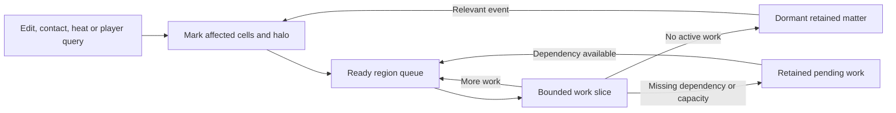

# Active-region scheduling: measured feasibility

October 27, 2026 (Denver). **Offline prototypes and investigation; not installed in gameplay.**

## Finding and recommendation

Active regions are useful, but AshenVoxel already avoids much of the cost they normally eliminate. The finite granular solver already visits an active queue, and Exploration already limits support work and uses native connected bodies. There is no whole-world per-voxel physics scan to remove.

The measured opportunity is a **hybrid**:

1. Preserve sparse queues and exact current update ordering for isolated activity.
2. Use chunk-local membership bitmaps when many cells in a region are active.
3. Keep awake debris in a motion list; keep dormant debris as retained matter that wakes on specific events. For the current single prop, reject distant pickup queries with a conservative bounds test before considering a spatial index.
4. Add a fair, resumable region scheduler when multiple simulations or prop sessions actually need it. Keep rendering demand and simulation activity distinct.

On this PC, a chunk-membership prototype reduced a dense sand workload's median CPU time by **17.0%**, with identical final serialized state and work counts. It did not establish a benefit for sparse activity. Actual settled-debris traversal cost approximately **0.032 ms per call** for4,001 parcels: removable work, but not evidence that it explains the current scene's major lag.

## What an active region means here

A region retains its matter even when none of its systems needs to run. Editing or changing a relevant neighbor wakes only the affected cells and dependency halo. A bounded slice advances those cells; unfinished work stays queued. A moving body can cross a quiet region and wake it. Visibility alone neither wakes physics nor authorizes deleting matter.

Noita's developer describes dirty regions inside64×64 chunks and a four-pass conflict-avoiding update schedule. That supports locality as a design principle; its 2D passes are not a safe ready-made schedule for our 3D writes. The prototypes here are single-writer. [Primary developer explanation](https://80.lv/articles/noita-a-game-based-on-falling-sand-simulation)

## Where it applies to current code

| Path | Existing behavior | Opportunity / limit |
| --- | --- | --- |
| [Core/Simulation.cs](../Assets/AshenVoxel/Core/Simulation.cs) | FIFO of active grains, membership and moved-cell HashSets, neighbor wake, settled cells leave the queue | Improve membership locality under dense activity. Idle grains already cost no candidates |
| [Runtime/DemoBootstrap.cs](../Assets/AshenVoxel/Runtime/DemoBootstrap.cs) | Runs that finite granular solver | A faster Core solver does not automatically accelerate normal Exploration |
| [NaturalTreePhysics.cs](../Assets/AshenVoxel/Exploration/NaturalTreePhysics.cs) | `StepLoose` returns early for sleepers, but `Step` still selects them from the loose list; pickup distance is checked before sleeping | Split ownership/visibility lists from awake work. Preserve pickup and kick wake behavior |
| Same support path | Certified neighbor searches plus retained budgeted work; initial certification and full array clears remain | Region summaries may help, but cannot skip an affected component's necessary support proof |
| [ExplorationNaturalTreeMatter.cs](../Assets/AshenVoxel/Exploration/ExplorationNaturalTreeMatter.cs) | One active session; support and ground queries already have checked slices | Start with a small lifecycle improvement; a global job framework is premature |
| [WorldExplorerVoxels.cs](../Assets/AshenVoxel/WorldScaleRuntime/WorldExplorerVoxels.cs) and terrain partials | Existing asynchronous mesh/refinement queues and memory admission | These are render/source workloads. Active physics scheduling does not solve their commit-memory pressure |

Mechanical sleep, thermal activity, support uncertainty and render dirtiness must be independent states. A hot stationary voxel still needs thermal/reaction work. A tint edit still invalidates appearance without waking gravity.

## Executed comparison

Environment: Windows, AMD Ryzen7 5800X, .NET8.0.407 SDK, optimized standalone C#, tiered compilation disabled. Other host activity was not controlled. No Unity, GPU, mesh upload, native rigid-body or full-scene FPS measurements occurred.

The runner froze source copies before compilation, recorded hashes and checked the originals afterward. **No compiled input changed during the accepted run.** Main code was not edited. Source, raw timings and conservation checks are in [run03](SimulationResearch/2026-10-27/active-regions-run-03/manifest.json), [results](SimulationResearch/2026-10-27/active-regions-run-03/results.json) and [compact summary](SimulationResearch/2026-10-27/active-regions-run-03/summary.json).

### A. Chunk membership while preserving FIFO

Only the two membership HashSets were replaced in an automatically generated copy of current `Simulation.cs`. The candidate uses4096-bit pages, a last-page lookup cache and epochs for moved-set clearing. **It does not reorder updates or skip any baseline candidates.** Each membership page has512 bytes of bitmap payload, plus metadata/array/dictionary overhead.

Median total CPU time across five fresh runs per variant, including initial wake scanning and simulation until quiet:

| Workload | Current queue + HashSets | FIFO + paged membership | Interpretation |
| --- | ---: | ---: | --- |
| Seven grains near chunk boundaries | 0.659 ms | 0.664 ms | Essentially tied; candidate0.9% slower |
|3,456 grains in a compact falling block | 71.810 ms | 59.605 ms | **17.0% less CPU time** for this complete workload |
|512 grains scattered through a25.6 m footprint | 68.744 ms | 70.208 ms | No demonstrated benefit; candidate2.1% slower, noisy samples |

These are total workload times, not milliseconds per frame. The dense case processed76,347 candidates and67,590 moves in both variants. All ten runs of each fixture produced identical snapshot SHA-256, candidates, moves and call count. The correctness sequence also compared ordered material-change events, tints, dirty chunks and per-call state under changing budgets.

Measured allocated bytes for the dense workload fell from551,872 to193,456. This includes authoritative world allocations; it is not solely set storage or a measurement of resident memory. The candidate retained16 membership pages across its two sets there, but1,536 pages for the scattered fixture—768 KiB of bitmap payload alone. Sparse regions can therefore lose the memory trade as well as the speed trade.

The scattered workload allocated roughly191 MiB transiently in either implementation. Source inspection suggests repeated creation/removal of material/tint chunks as isolated grains move is a separate contributor; this run did not instrument allocation stacks to prove an exact attribution. Changing the active-set representation does not remove that cost.

**Decision:** keep the present FIFO behavior as the oracle. Investigate a sparse/dense per-region representation with promotion/demotion hysteresis and bounded page retirement. Do not universally replace HashSets with the tested retained-page candidate.

### B. Current debris really does revisit sleeping parcels

The harness used the actual current `NaturalTreePhysics` source with a synthetic connected100,000-cell upper block on a small stem. After cutting, settling and release,100,001 logical cells were represented by4,001 weighted parcels. All4,001 sleeping flags were verified.

Over600 calls, the current solver still visited **2,400,600 parcel candidates**, while pose revision, cargo and conservation remained unchanged. Median/p95 per-call costs were:

| Situation | Median | p95 |
| --- | ---: | ---: |
| Pickup disabled |0.0317 ms |0.0322 ms |
| Pickup enabled, player far away |0.0323 ms |0.0378 ms |

An awake-only list could eliminate those candidate visits when pickup is disabled. With pickup enabled, a conservative whole-pile bounds rejection can first establish that no dormant parcel is in range. Sleeping parcels must still be stored, rendered and eligible for future collection/kicks. These expected visit reductions have **not** been integrated or measured as a live replacement.

At this scale, the absolute saving is small. The stronger reason to establish this separation is to support multiple independent piles and later heat/fluids without repeatedly walking every dormant member.

### C. Spatial regions versus a simple bounds test

An independent index queried the actual settled snapshot. It supports move/removal, including negative coordinates. All alternatives returned the same ID set, using a4 m pickup radius. The table uses3.2 m regions—two existing chunks per axis—selected as a promising experiment, not a new world resolution.

Median query CPU times below are microseconds, measured in batches; they exclude motion, collection commits and live index maintenance:

| Player position | Full scan candidates | Region candidates | Full scan | Region query |
| --- | ---: | ---: | ---: | ---: |
| Far outside pile |4,001 |0 |8.89 µs |0.14 µs |
| At pile edge |4,001 |1 |8.81 µs |0.18 µs |
| Near pile center |4,001 |2,871 |10.61 µs |6.46 µs |

Building that index took0.176 ms and allocated430,696 bytes in the measured construction. That is a real cost, and it can exceed the value of indexing a small short-lived pile. A whole-pile AABB check also rejected the far query without scanning any parcels and was cheaper than walking region buckets. Its nanosecond microbenchmark value is too small to present as meaningful gameplay timing.

1.6 m buckets caused more empty bucket lookups.6.4 m buckets inspected1,046 candidates at the edge to find the same single match;3.2 m needed only one candidate. At the center,6.4 m and3.2 m had similar timing. More shapes, camera/player paths and query radii are needed before choosing a production size.

**Decision:** bounds first for one active session. Consider a per-region dormant index when multiple piles, local kicks, fire/heat queries or large spatially sparse scenes justify it. This is a spatial-query prototype, not yet a budgeted motion scheduler.

## Proposed scheduler contract

Keep the core material chunk at16³/1.6 m. A scheduling region may group chunks without changing10 cm matter or cache identity. Start with one writer and existing ordered edit commands.

| Concern | Proposed rule |
| --- | --- |
| Admission | First active cell enqueues its region once; duplicate notifications only set membership. Keep a dense-ready queue and sparse membership inside each region |
| Tick semantics | Separate logical simulation tick from frame slices. Persist moved/current/next state until that tick ends. Current `Step` increments `Tick` per call, so repeated calls are not a free way to subdivide one tick |
| Wake halos | Granular edits wake the existing26-neighbor dependency neighborhood across chunk faces, edges and corners. Heat/fluid/support get their own correct dependencies |
| Fairness | Rotate ready regions with a bounded candidate quantum; reserve service for older work so a nearby continuing blast cannot starve another region. Treat this as a behavior change that needs reference tests |
| Sleeping | No ready members means dormant. Keep matter and subscriptions. Native active sections continue independently of dormant-cell scheduling |
| Dependencies | Unknown/unloaded neighbor is not air. Retain transfers and pending work until the dependency or capacity is available; do not repeatedly spin blocked regions |
| Time limits | Count limits plus checked elapsed slices and maximum-item telemetry. Retain the cursor when a budget expires; count limits alone cannot bound one expensive item |
| Index maintenance | Insert when a parcel sleeps; remove on wake/collection; update or invalidate on pose/source changes. Rebase must not change global ownership. Conservative stale bounds may over-admit work but must never omit it |
| Pickup timing | A newly woken sleeper must start with an explicit wake-time policy; skipping its old visits must not turn long sleep time into one enormous suction step |
| Retirement | Retire empty membership pages under a separate budget; pin pending work. Reuse small pools within limits rather than retaining every region ever touched |
| Diagnostics | Per-system ready/blocked/dormant counts, active cells, oldest work age, completion time, processed candidates, pending transfers, memory and worst slice/item cost |

An actual regional round-robin scheduler would change the present cell FIFO order. The successful bitmap equivalence tests do **not** validate that change. Likewise, neither experiment validates multithreaded writes. Parallel reads plus deterministic commit can be considered later; safe checkerboard passes require proving the maximum3D write footprint, including long movements and explosions.

## Narrow implementation sequence

**First, for current Exploration:** separate loose-matter ownership from the awake iteration list, maintain conservative dormant bounds, and explicitly wake on collection-range changes, kick, changed ground/contact, new debris and future reactions. Preserve weighted tails and pending releases. Test player movement into/out of range, pickup toggles, a kick from sleep, ground/source invalidation, low body budgets, restore and eight-slot liveness. Native rendering must still see all dormant parcels.

**Second, for the granular/reaction foundation:** build a hybrid membership container from the measured candidate, with sparse entries and dense pages selected by observed occupancy. Preserve current FIFO ordering initially. Profile a stable dense pile, tiny edits, scattered grains and repeated travel through regions, including retained memory after activity ends. Only adopt if mixed workloads and memory limits improve.

**Third, when multiple active systems exist:** introduce resumable region jobs with aging/fairness and explicit logical ticks. Add finite-event backlog drainage, blocked-neighbor resume, boundary wake, tint isolation, repeat-update prevention and deterministic reference checks. Introduce field-specific activity rather than one flag meaning that everything in a region runs.

A small dormant-list improvement is the best first production candidate; a broad scheduler rewrite is not justified by these results alone. Dense bitmap membership is promising for future sand/reactions but currently does not accelerate the normal Exploration code path.

## Validation, failed attempt and reproduction

The accepted run passed **399,228 assertions**. The existing core suite separately passed **all91 checks**, including .NET Standard2.1 compilation and the external mutation-boundary probe. [Core log](SimulationResearch/2026-10-27/active-regions-run-03/core-checks.log), [snapshot equivalence](SimulationResearch/2026-10-27/active-regions-run-03/equivalence.json).

Run01 failed a test-fixture assumption: a sand cell chosen for a tint-only edit had already moved, so the edit legitimately woke physics. The corrected test uses a known unmoving stone cell. Run02 is retained as preliminary evidence; its spatial scan counted matches while the first index produced lists, so those query timings are superseded by run03's matching-output comparison. Run03 also uses contiguous bucket entries and checks final serialized hashes. Earlier runs are not relabeled as testing this revision. [Run history](SimulationResearch/2026-10-27/ACTIVE_REGION_RUNS.md).

Reproduction and exact experimental scope are in [Tools/ActiveRegionStudy](../Tools/ActiveRegionStudy/README.md). Builds remain under ignored `bin/`. No gameplay source, scene, package, generator, saved preference or release was changed by this investigation. Current native/large-tree/distant-terrain acceptance gates remain open.
