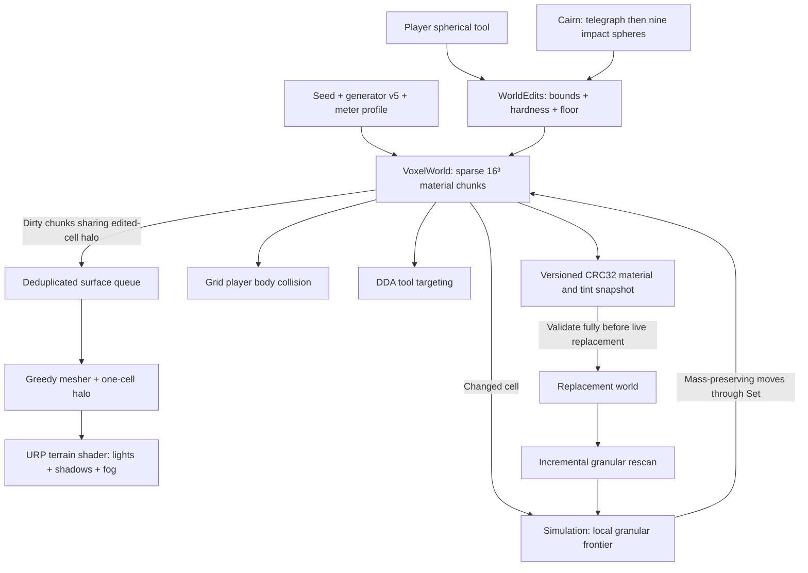

# Implemented data flow

This document describes the **finite authoritative-matter/arena path**. The
current default Exploration scene additionally uses a shared terrain field and
streamed prop prototypes; see [AI_HANDOFF.md](AI_HANDOFF.md) and
[FILE_MAP.md](FILE_MAP.md) for that data flow and its distinct authority/limits.

The simulation owns matter. Meshes describe a recent surface of that matter and may lag while their bounded queue drains. The player and tools query current cells, so removing ground changes collision and targeting immediately.

## Runtime order

`DemoBootstrap.Start` configures lighting, generates the finite arena, attaches the gravity subscriber, then progressively meshes startup chunks. Player input and the boss are created after that surface pass. Generation is synchronous, and startup meshing spreads across frames; these are different costs.

During normal `Update`, a capped accumulator runs at most two 30 Hz simulation steps. The player tool then edits current material data, followed by the budgeted terrain surface pass. `GridWalker.Update` is a separate Unity callback; no reliance is placed on its order relative to meshing. Boss attacks are coroutines issuing a short sequence of synchronous sphere edits, one per rendered frame. Consequently, newly disturbed matter can wait until the next fixed simulation opportunity, while collision sees edits immediately. Candidate/chunk counts bound work units, not wall-clock duration.

The renderer initially omits colliders because the player uses grid collision. Optional MeshCollider generation is a separate cache and is not the authority for the provided controller. Moving tree/stone islands, a physical boss body, and third-person controller integration are future work with their own collision contracts.

## Contracts to preserve

| Boundary | Current contract |
| --- | --- |
| Cell coordinates | Integer x/y/z, finite bounds, outside reads return air |
| Physical coordinates | Meters; required cell width0.1 m |
| Mutation | VoxelWorld.Set, revision increment, one origin changed event, one-cell halo neighbor dirtiness (1/2/4/8 chunks) |
| Materials | Stable byte IDs; basic hardness/density/flammability/granular metadata |
| Cellular motion | Single writer; no duplicated mass; a grain moves at most once per Step |
| Sleep/wake | Nearby edits wake loose cells; load rescan is incremental and observable |
| Picking | Normalized metric hit distance from DDA, independent of visible meshes |
| Rendering | Material-aware extracted surfaces, reusable chunk meshes; no object per cell |
| Saving | Complete material/appearance snapshot; sorted chunks and CRC; protected by atomic file replacement in runtime |
| Loading | Schema, size, material, coordinates and checksum validated before replacing world |
| Replay | Seeded generation repeatable in tested runtime; snapshots do not preserve tick/frontier or guarantee exact continued replay |
| Threading | Current world has one main-thread writer; no worker accesses mutable chunks |

## Where the next systems connect

A structural solver should subscribe to edit commands or changed-region summaries and maintain a separate support graph. Once a complete detached component is identified under a bounded traversal, its cells can transfer to a local voxel body as one transaction. Body pose belongs to Unity physics; body material remains queryable and renderable without converting every cell into a Rigidbody.

A new renderer should consume versioned immutable chunk snapshots and return caches tagged with the sampled revisions. Discard stale completions. A Burst job must not read arrays while the main thread mutates them; introduce explicit ownership or copy snapshots first. A GPU brick renderer also needs conservative acceleration invalidation, declared RenderGraph resources and correct depth/shadow/motion integration. None of that is provided merely by replacing the mesher with a compute dispatch.

A region persistence layer can replace whole-world snapshots later. It must preserve source generator/profile identity, modified material payload, migrations and crash-safe publication. The initial snapshot format has no asynchronous scene ownership or network replication semantics.

Tree generation now uses one validated genome/skeleton/raster pipeline across four species. Optional packed sRGB tint arrays are separate from material IDs. Tint-only edits emit `AppearanceChanged`, increase revision and invalidate halo meshes, while physical material edits emit `Changed`. See [tree/color guide](TREES.md).

Small ground plants and rocks now enter through a separate bounded morphology
API. WorldScaleData reads the source-biome surface column, plans globally keyed
habitat candidates, then materializes a finite canonical rock/shrub/herb order
through the same Core Set path. The workshop invokes those generators directly
for isolated specimens. No per-cell renderer objects or alternate material
authority are introduced. Shape generation, global placement and distant
representation remain separate; only finite editable placement is implemented.

Actor collision queries now use MaterialCatalog.BlocksActorBody. Soft Leaves,
Fungus and Petal can be passable while DDA/tools and meshing still see solid
matter. GridWalker exposes an explicit solid-foliage override. See
[ground-cover report](GROUNDCOVER_UPDATE.md).
