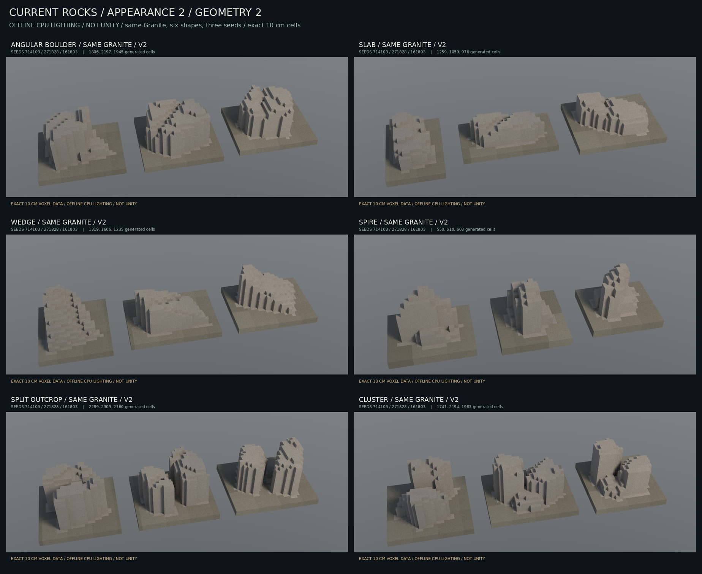

# Current procedural rock appearance — offline preview



These are **actual current C# voxel-generator outputs**, rendered with offline
Mitsuba CPU lighting. They are **not Unity screenshots** and do not establish
the prototype's real-time lighting, performance or a visual match to Avroid's
inaccessible newest video.

Every panel uses Granite on the **10 cm grid**, with seeds **714103, 271828 and
161803**, left to right. The six forms are AngularBoulder, Slab, Wedge, Spire,
SplitOutcrop and Cluster. Each specimen sits on an authored voxel presentation
pad. Shapes use **RockGenerator.Version 2**; their revised intrinsic pigment uses
**AppearanceVersion 2**. This is the same current rock generator used to bake
the Exploration prototype pack.

[Enlarged granite detail and its stored palette](granite-palette-detail.png)
show seed 271828. This specimen uses five of the generator's six available
pigment shades. The detail is a labelled 2× nearest-neighbor image crop, with
unlit sRGB palette swatches beneath it. Face-to-face brightness also comes from
the offline key light, sky and occlusion; that lighting is not baked into the
stored colors. Large coherent pigment patches and small warm/cool shifts replace
the earlier broader brightness variation. This remains an artistic starting
point; no reference-frame color calibration was possible.

The earlier `Docs/RockShapeGallery` images retain their historical data and
pigment provenance. They were not overwritten or relabelled as this update.

## Reproduce and inspect

With .NET 8 SDK and the existing renderer's Python dependencies installed, run
from the project root:

```sh
python3 -m pip install -r Tools/GroundCoverPreview/requirements.txt
python3 Docs/ExplorationPreview/reproduce.py
```

The small wrapper compiles a frozen snapshot of the current Core and the existing
`Tools/GroundCoverPreview/ExportGroundCover.cs`, then calls the existing exact-face
renderer. It uses **64 samples per pixel, two CPU threads and render seed 42**.
Only faces bordering air are emitted; no substitute rock geometry is used.
The wrapper adds a separate appearance-version annotation read from the compiled
source, because the older shared exporter only emits the rock geometry version.

Temporary binaries and sparse datasets remain under the existing excluded
`Tools/GroundCoverPreview/bin/exploration-appearance-v2` directory. No Unity
runtime assets or historical gallery outputs are changed. Later generator or
appearance versions should get a new preview directory.

[preview-validation.json](preview-validation.json) records source hashes, input
hashes, image hashes, versions, camera/renderer provenance links and the detail
crop coordinates. The six `shape-*.report.json` files record the actual renderer
settings and elapsed times. CPU/compiler differences can change rendered pixels;
these images are not a portable pixel-identity guarantee or a GPU benchmark.
