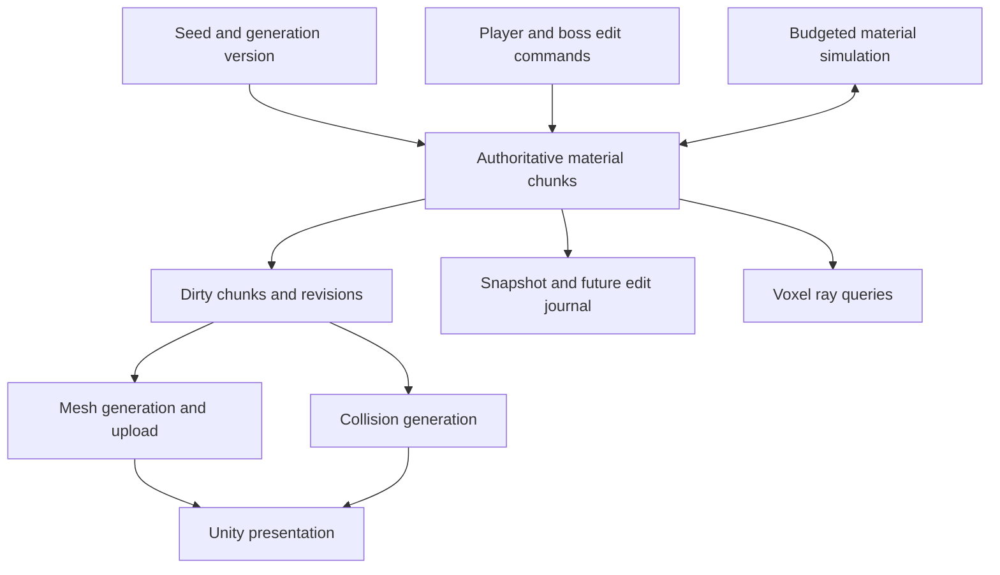

# Ashen Voxel — foundation plan

This project starts a dark fantasy action game whose environment is made of editable, materially distinct voxels. Its first purpose is to test the ground beneath the future game: what a destructive boss attack costs, what falls afterward, how the changed surface looks, and whether play remains responsive.

The latest visual reference is **Avroid**, supplied by the user. Use it as the primary appearance reference, with the earlier dark fantasy/Souls-like mood as a secondary direction. The world should have mountainous forest, readable rock and organic materials, procedural trees, atmospheric separation, and a clear combat arena. This does not assert that Avroid uses the same engine or rendering technique.

The current physical requirement is **one voxel per 10 cm** (`0.1 m`). Generation, simulation, collision, and display must agree on that scale. Surface shading can add finer visual texture without changing the material grid. Smaller cells are an optional future choice, not an assumed milestone. Composition, lighting, surface variation, and temporal stability are as important as cell density.

## Scope and evidence

The initial repository is an editable Unity prototype, not a finished engine or an established performance result. Read the implementation and the current README for exact demo controls. The architecture deliberately leaves expensive production features behind measurable gates.

The initial implementation work is organized around:

- A Unity-independent C# material grid in sparse 16 × 16 × 16 chunks.
- Deterministic seeded terrain and tree generation inside a finite demonstration domain.
- Direct material-aware sphere edits for digging and placing matter.
- An active frontier for granular gravity, with a finite work budget.
- Chunk-local exposed-face greedy meshing and a vertex-color lit Unity renderer.
- Grid traversal for voxel targeting, independent of the visual mesh.
- Versioned snapshot persistence and core correctness checks.
- A playable exploration/destruction scene with a destructive encounter demonstration.

These are implementation objectives for this first delivery. They are not evidence that every path has already been compiled or played. In particular, a Unity Editor and an appropriate license must be available before Unity compilation, visual inspection, player builds, and frame-time measurements can be claimed.

The project does **not** yet establish a production solution for streaming, arbitrary structural collapse, rigid voxel islands, fire spread, fluids, networking, GPU voxel traversal, or millions of active simulated cells. The roadmap below makes those separate projects with explicit admission criteria.

## 1. Design priorities

1. **An authoritative world that survives renderer changes.** Material state, edits, and persistence must not live in meshes, GameObjects, or shader textures alone.
2. **Bounded expensive work.** A boss can create more work than one frame can finish. Meshing, support analysis, physics updates, and simulation must have deliberate scheduling and backlog behavior.
3. **Playable destruction.** Attacks need readable material response and immediate targeting feedback. A large explosion must not silently erase a frame budget or trap a player in stale collision.
4. **High material fidelity.** Stone, compact earth, wet mud, litter, wood, and foliage have different reasons to remain in place, break, fall, burn, or obstruct movement.
5. **Graphics with intent.** Dark fantasy requires coherent silhouettes, roughness hierarchy, atmospheric depth, local contrast, and spatially stable detail. Random colors and uniformly tiled trees undermine the goal even with very small cells.
6. **Reproducible changes.** Seeds, generation version, material IDs, edit coordinates, simulation rules, and save version are part of a testable contract.
7. **Compatibility without unnecessary dependencies.** Start with a supported Unity LTS family and URP. Introduce third-party systems only after a focused compatibility and ownership review.

## 2. Unity and rendering baseline

Use a currently supported Unity 6 LTS editor, pin its exact patch in `ProjectSettings/ProjectVersion.txt`, and resolve the compatible URP release through Unity Package Manager. Keep the editor and resolved package versions together in source control after the first successful import. The repository's selected editor version is the operational source of truth; see the decision log for the confidence attached to that choice.

The reason to prefer LTS is a longer support window and reduced upgrade churn, not a promise that every Asset Store addon will work. Asset compatibility is package-specific. A plugin that depends on HDRP, a particular input backend, an obsolete rendering hook, or a native library requires a separate check. Do not move the project's editor forward only because a newer feature release exists.

Use URP as the first graphics integration point. It offers a broad ordinary mesh workflow, a practical path for a custom lit voxel material, and an eventual custom renderer feature without requiring a fully custom engine. HDRP remains a viable PC-focused option if its lighting and volumetric features justify the additional custom-rendering integration cost. Switching pipelines is a reviewed migration, not a per-scene toggle.

## 3. World state and coordinate contract

### Authoritative matter

The core stores material IDs. A cell occupies `[x*s,(x+1)*s)` on each axis, where `s` is voxel size in meters. Grid addressing uses integer cells; player tools and rendering cross the meter-to-cell boundary explicitly. A finite prototype bounds the possible address range. A production streamed world will use signed chunk coordinates and a floating origin for rendering and physics.

Air is material ID zero. Stable IDs belong to save formats, tools, material tables, and future network packets. Never reorder IDs casually. Future material additions require a data migration or an append-only ID policy.

Each 16³ chunk contains 4,096 material samples. An all-air chunk may be absent. The initial sparse dictionary removes empty chunks and allocates material arrays only when non-air cells exist. This is sparse at the chunk level; a single cell still costs an entire dense chunk payload. It is not a sparse octree or a compressed DAG.

The grid is authoritative even when a mesh rebuild is pending. Edits must use the world's mutation API so revision tracking, dirty marking, neighbor invalidation, and simulation activation remain consistent. Direct array writes are internal operations with matching invariant maintenance, not a public gameplay shortcut.

### Derived systems

The production design should replace a single destructive dirty set shared among consumers with independent revision cursors. Rendering, collision, save checkpoints, networking, and navigation must be able to discover changes independently. A consumer removing a dirty marker must not prevent another consumer from seeing the same edit.

### Future state channels

Material identity must not grow into one enormous mutable struct copied everywhere. Introduce additional channels only when a feature needs them:

| Channel | Candidate representation | Activation rule |
| --- | --- | --- |
| Material | 8- or 16-bit stable ID | Resident material chunks |
| Temperature | Quantized scalar in sparse active thermal bricks | Fire, hot matter, or cooling region |
| Fuel / moisture | Quantized material state | Reactive materials near active processes |
| Damage / stress | Sparse local accumulator | Recently impacted structural matter |
| Rigid island owner | Local component map or entity association | Detached coherent bodies |
| Density / SDF | Separate field when smooth geometry is selected | Terrain representation that needs it |

Do not allocate all channels for every cell on day one. A temperature channel alone doubles the base storage if stored as one byte per cell; a float temperature makes it five times the material-only payload before overhead.

## 4. Procedural generation

### World structure before noise detail

Build the world in stages. Every stage has a seed derived from a global seed and an explicit stable identifier so changing foliage does not accidentally move mountains.

1. **Macro layout:** mountain ridges, valley corridors, arena basin, traversal routes, landmark silhouettes, and reserved combat space. This stage is gameplay-aware.
2. **Base rock volume:** height and overhang fields with ridged multi-scale noise and limited domain warping. Reserve true volumetric sampling for features that require it.
3. **Erosion-informed shape:** drainage routes, talus accumulations, cliff exposure, and slope-dependent sediment. The initial noise terrain is not a hydraulic erosion simulation.
4. **Material stratification:** stone depth, moisture-dependent mud, soil, litter, and sparse living ground cover. Place materials using surface depth, slope, and moisture rather than fixed horizontal bands everywhere.
5. **Vegetation placement:** deterministic spatial candidates filtered by slope, moisture, rock exposure, path clearance, and canopy competition.
6. **Tree geometry:** rooted trunk and branch skeletons with tapered voxelized segments, roots entering earth, irregular canopies, and material identity preserved through the entire tree.
7. **Small spatial variation:** moss, lichen, exposed roots, dead wood, patchy litter, and restrained color variation.
8. **Validation:** free spawn volume, reachable arena access, bounded generation cost, material histogram, and enough terrain depth for the destructive encounter.

The demo now uses finite Generation v5. Terrain and strata remain meter-based and receive coherent persistent pigment variation. Forest placement uses mixed oak, birch and pine presets from the same reusable tree generator; the separate Tree Workshop also exposes a mature75 m coast redwood with physical bark relief and basal fluting. A validated genome controls branching, taper, whorls, crown envelope, age, foliage form and palettes. Skeletons have parent-indexed curved segments, local roots, supported foliage sprays and optional acorns, with explicit generation caps. Thin branches retain six-neighbor digital spines on the required10cm grid. This is a constructive grammar, not a space-colonization, competitive growth or ecological root simulation. Erosion, ecological forest competition, streaming and structural collapse remain later work. See [tree guide](TREES.md) and [research](TREES_RESEARCH.md).

### Material slices

A typical forest slice can contain stone → mud → dirt → litter → grass, with roots and wood crossing those layers and leaves appearing in the canopy. That sequence is a useful example, not a universal vertical law. Rock outcrops omit soil; steep slopes carry little litter; waterlogged depressions accumulate mud; tree trunks replace several surface cells.

Forest ground should not become a continuous thick green shell. Use broken coverage and dark organic material to make excavations legible. At microvoxel scale, surface occupancy variation can supply much of the silhouette detail while shader noise supplies detail smaller than a cell.

### Trees and destruction

The first procedural trees are voxel matter. Their connectivity should be observable after cutting, even before a complete structural solver exists. Production tree behavior needs a deliberate ownership model: a rooted structural graph for intact trees, a detached rigid body or bounded fragment set after separation, and granular/particle debris for splinters. Leaf occupancy can remain voxel-based while distant canopy shading uses an alternate representation.

Never put a Rigidbody or GameObject on each wood voxel. A tree is a connected object with hierarchical structure, not thousands of independent physics actors.

### Generation determinism

For a persistent world, a seed is insufficient. Save the generator version, world dimensions/scale, material mapping version, and any generation parameters. Cross-platform identical generation needs integer hashing and carefully controlled arithmetic. A floating-point noise implementation that is repeatable on one runtime does not prove cross-platform replay determinism.

## 5. Material simulation and destruction

### Separate behavioral categories

A useful material model distinguishes:

- **Bedrock and coherent solids:** remain until damaged or identified as unsupported by structural analysis.
- **Loose grains:** fall and settle into air according to local rules.
- **Cohesive wet ground:** yields differently from sand and may retain short-lived unsupported shapes.
- **Wood structures:** transmit support, fracture across connected regions, and can burn.
- **Foliage and litter:** low mass, low resistance, sparse visibility, and fuel behavior.
- **Fluids and gases:** require their own transport, conservation, and pressure rules.

The first demo implements granular motion and material-aware removal. A material table containing `Flammable` is an extension point; it does not constitute a fire simulation. Hardness and density values begin as design coefficients, not calibrated physical units.

### Active granular frontier

Only cells made potentially unstable by changes need immediate work. Edits activate nearby cells; a move activates its source, destination, and dependent neighbors. A sleeping settled region should cost very little per frame.

A budget counts candidate processing separately from successful movement. A dense settled queue can still be expensive even if almost no grain moves. Deduplicate activation, prevent a cell from moving repeatedly in one step, and keep queue behavior deterministic for a fixed command stream and step schedule.

The current gravity model is **cellular settling, not accelerated physical fall**. Each grain can move at most one cell downward per simulation call, optionally sideways into a downward diagonal. The demo calls it at 30 Hz: at the required 10 cm scale this gives an upper vertical transport rate of 3 m/s when a grain is processed every tick; candidate backlog can make it slower. There is no accumulated velocity, acceleration, momentum, or calibrated soil cohesion. Diagonal moves also change horizontal position. This can produce useful Noita-like settling without reproducing Noita's complete implementation or material system. Later ballistic/substep models must preserve collision and conservation while defining their own speed and cost limits.

### Boss attack command path

Every world-changing attack should become an explicit command with shape, location, material interaction, and a stable sequence number. The first sphere edit proves the path; future attacks can add capsules, swept blades, shockwaves, directional cuts, or signed-distance brushes.

A production attack pipeline is:

1. Validate and quantize the shape in world coordinates.
2. Compute affected chunk ranges with an upper bound on work.
3. Apply authoritative material changes in deterministic order.
4. Activate granular and structural work around changed surfaces.
5. Publish dirty revisions and an attack feedback event.
6. Rebuild visible surfaces and collision under separate priorities.
7. Spawn a bounded visual debris effect from the attack feedback event.

Do not make damage depend on visual particles striking a mesh. Particles can make an attack look powerful without becoming an uncontrolled source of authoritative edits.

### Structural collapse milestone

Granular gravity does not imply that a cut tree falls or a stone arch collapses. For coherent solids, investigate connected components seeded by changed cells and a root/anchor rule. A useful first rule is connectivity to protected ground; that remains a gameplay approximation, not an engineering stress solver.

After identifying a detached component:

- Keep the classification bounded by region size and cancellation/version checks.
- Decide whether it becomes one rigid island, several fractured islands, or granular rubble.
- Use simplified convex collision for moving islands; preserve voxel data for later edits.
- On rest, either remain a body or revoxelize under a documented overlap/conservation rule.
- Limit active islands and total collision complexity explicitly.

Large support graphs, fracture energy, bending wood, and physical stress propagation are later research choices. Begin with repeatable connectivity tests and destructible tree cuts.

### Fluids and fire milestone

Water and fire should enter through the same material state and edit framework, but neither should be implemented as a few unscheduled neighbor checks. Define conservation, time stepping, state storage, chunk-border exchange, and sleep/wake behavior first. Fire consumes fuel and transfers heat; water transports volume and potentially carries sediment; steam and smoke need a chosen gameplay purpose and bounded storage.

## 6. Rendering strategy

The first renderer is greedy exposed-face meshing. It merges coplanar visible cells where the face attributes allow merging, builds chunk meshes, and uses ordinary URP rasterization. That provides a debuggable baseline for editing, collision, shadows, and material appearance.

The intended final renderer remains a decision to be measured:

| Technique | Strength | Cost or mismatch for this game | Role |
| --- | --- | --- | --- |
| Exposed greedy meshes | Standard Unity lighting, shadows, tooling, and collision integration; good coherent flat surfaces | Destruction requires remeshing; tiny irregular surfaces can defeat merging; chunk seams and AO merging need care | Baseline and viable near-term renderer |
| Surface nets / dual contouring | Smooth silhouettes, compact surfaces, contour-preserving variants | Requires density or SDF semantics; changes the discrete matter appearance; topology and material boundaries need careful treatment | Optional smooth-terrain branch |
| Sparse voxel octree ray traversal | Hierarchical empty-space skipping and adaptive spatial detail | Dynamic topology updates, GPU residency, lighting, and Unity depth/shadow integration are substantial work | Research alternative |
| Sparse voxel DAG | Strong sharing for repeated static subtrees | Destructive edits can break sharing and require copy-on-write bookkeeping | Static distant scenery or research, not initial mutable authority |
| Sparse brick pool + occupancy hierarchy + DDA | Local updates fit brick granularity; simple local matter sampling; GPU-friendly dense bricks | Ray divergence, many small cells, secondary rays, temporal filtering, and GPU upload become central costs | Strong production prototype candidate |
| Hybrid mesh / ray-traced bricks | Keeps conventional characters and selected geometry while giving voxel terrain a specialized path | Requires consistent depth, shadows, motion, material shading, and edit visibility across paths | Likely long-term integration shape if brick prototype succeeds |

No representation wins solely because it is newer or appears in an attractive Reddit clip. Compare the same destructible scene, camera paths, lighting, and hardware. Separate display of static scans from real-time editable game worlds.

### Graphics milestones

1. Establish color-managed lighting and a controlled dark fantasy palette.
2. Add stable material variation keyed to world position and material identity.
3. Add contact shading or vertex ambient occlusion without producing chunky checkerboard artifacts.
4. Define wood grain direction, exposed soil color, wet mud response, and rock roughness.
5. Add restrained fog and atmospheric depth while preserving attack readability.
6. Prototype high-quality indirect light and contact shadows with the selected renderer.
7. Evaluate temporal anti-aliasing, upscaling, and camera motion against subpixel voxel shimmer.
8. Introduce LOD with explicit silhouette and transition tests.

Color variation must not force every microvoxel into its own mesh quad unless that tradeoff is measured. Material identity, surface color, and merge keys are related but separate concerns. Shader variation can preserve large merges; per-face AO may require additional merge constraints.

## 7. Collision and player interaction

Use grid traversal for targeting, not raycasts against a surface that may be stale after an edit. Visual meshes and collision meshes may rebuild at different times; the authoritative voxel query remains immediately correct.

The initial character controller may use Unity collision for walking. This creates a known contract: terrain edits can precede collision updates. Before production combat, choose and test one of these approaches:

- Prioritize collision rebuilds near the player and cap how long they may lag.
- Use direct voxel collision for the player, with dedicated support for slopes, stairs, and moving islands.
- Keep a conservative physics proxy while a detailed collider is pending.

A player must not fall through temporarily missing collision or stand indefinitely on removed ground. Boss bodies, falling islands, projectiles, navigation, and the player have different collision needs; they do not all require the same microvoxel collider.

## 8. Persistence, recovery, and tooling

The current save is a versioned material/appearance snapshot (Format2, with Format1 migration) with integrity checks and validated dimensions/material IDs. Runtime load validates a temporary world and the 10 cm contract before replacement, cancels the boss attack, resets the actor, searches body-clear spawn space, and schedules an incremental allocated-chunk rescan to reawaken saved grains. The scan progresses under a separate candidate budget while simulation is unpaused. It does not restore the exact active frontier, tick, player state, or attack schedule, so a loaded unsettled pile can settle in a different order. These runtime paths still require the Unity smoke protocol. Save files are untrusted input: validate sizes before allocation and reject corruption.

Before larger worlds, add an atomic write protocol: write a temporary file, flush, then rename into place while keeping a previous valid checkpoint. Checksums detect accidental corruption; they are not authentication or malicious-tampering protection.

Production persistence should be seed + generator version + changed chunk snapshots and/or an edit journal. A journal needs sequence numbers, bounded replay, checkpoints, and a policy for simulation-derived changes. Do not assume a log of player clicks can reproduce all simulation states under a variable frame budget.

Editor and debug tools are part of the foundation:

- Chunk bounds, material ID inspection, and active-cell overlays.
- Per-system timing and queue-length counters.
- Fixed-seed regeneration and replayable attack scenarios.
- Save/load roundtrip checks, corrupted-file rejection, and memory limits.
- Material histograms, chunk occupancy statistics, and mesh counts.
- Explicit benchmark presets rather than an unlabeled FPS number.

## 9. Delivery roadmap and admission gates

The order below is deliberate. Dates are planning ranges for focused work, not a delivery promise.

| Phase | Work | Gate before moving on |
| --- | --- | --- |
| Foundation prototype | Material chunks, finite generator, edits, grains, renderer, traversal, saves, playable demo | Core checks pass; Unity opens without compile errors; edit and save/load loop manually exercised |
| First profiling week | Instrument main thread, render thread, GPU, GC, collider work, queue age | Reproducible baseline captured on named target hardware; no hidden full-world per-frame scans |
| Weeks 2–3 | Burst/Jobs meshing and simulation candidates, immutable job snapshots, revisions | Equal authoritative output to reference scenarios; no stale-job overwrite; worst-case edit latency improves |
| Weeks 3–5 | Structural support, falling tree/rock island prototype, attack event model | Cut tree and bridge scenarios repeat; bounded body counts; player remains stable during collapse |
| Month 2 | Streaming, changed-chunk persistence, generator staging, art scene | Walk through a world larger than resident memory; seam-free generation and edits; save recovery test passes |
| Month 2–3 | Mesh versus sparse-brick GPU renderer comparison at 10 cm, material shading, lighting | Same physical scene measured on target hardware; selected renderer meets documented quality and budget goals |
| Later | Water/fire, navigation updates, richer boss behavior, multiplayer decision | Each system has its own conservation/latency/performance tests before entering the main branch |

Do not begin multiplayer by sending entire mutable arrays each frame. Decide whether it is required after core world edits are represented as stable commands. Authority, prediction, correction, and bandwidth depend on the simulation model; adding networking afterward will still be a substantial project.

## 10. Concrete acceptance scenes

Maintain these as reproducible fixtures:

1. **Layer cut:** excavate through forest cover into rock; verify materials, hardness response, and clean chunk boundaries.
2. **Sand shelf:** remove support below a granular shelf; verify motion, conservation, termination, and active queue decay.
3. **Cross-chunk crater:** apply the same sphere straddling two, four, and eight chunks; verify no missing faces or stale target hits.
4. **Repeated boss impact:** use a fixed impact sequence at fixed simulation steps; track queue age and frame-time tails.
5. **Tree cut:** first demonstrate the known unsupported-wood limitation; later replace the expected outcome with an island-collapse assertion.
6. **Save under change:** snapshot after a fixed sequence, load, and compare material and tint hashes; test truncated and corrupted files.
7. **10 cm camera path:** walk slowly and rotate across detailed rock, soil, tree, and foliage silhouettes at the required scale; inspect shimmer, shadows, material readability, and future LOD. Finer-cell comparisons are optional experiments only.
8. **Player escape:** destroy terrain under and around the player while moving and jumping; measure collision lag and recovery.
9. **Travel and return:** after streaming arrives, alter a distant region, leave its residency radius, return, and verify exact persistence.

## 11. Open choices, answered provisionally

No user answers are required to begin. The provisional choices and their alternatives are in [DECISIONS.md](DECISIONS.md). Prior project conversations were not available in this workspace, so they have not been silently treated as requirements.

The physical scale is now decided: 10 cm per voxel. The most consequential unresolved choice is the production rendering and simulation backend at that scale. The foundation should be judged through Avroid-informed scene quality, playable destruction, and bounded updates rather than by promising smaller cells.

## 12. Foundation risk register

| Risk | Early warning | Mitigation and fallback | Exit evidence |
| --- | --- | --- | --- |
| Fine resolution overwhelms memory | Material and mesh residency grow beyond the target budget before gameplay systems exist | Stream chunks, omit uniform regions, separate appearance from active simulation, or coarsen distant matter | Memory capture for target-scale scene and travel route |
| Destruction overwhelms meshing | Dirty queue age rises through repeated attacks | Smaller work units, revisioned jobs, priority scheduling, sparse-brick renderer comparison | Bounded p99 edit-to-visible latency under sustained attacks |
| Collider cooking stalls or creates holes | Long physics spikes or temporary loss of player support | Authoritative player grid collision, simplified proxies, near-player priority | Player-escape scenario with collision latency capture |
| Granular model behaves unlike coherent soil | Whole slopes liquefy or unsupported wood never falls | Distinguish loose grains, cohesive matter, and structural components | Designed soil shelf and tree-cut outcomes |
| Simulation loses matter under parallel work | Cell counts drift without an intended reaction | Preserve reference implementation; explicit movement claims and phase barriers | Conservation tests over randomized fixed-seed fixtures |
| GPU route looks fast but cannot integrate | Missing character depth, edit shadows, or unstable temporal results | Prototype full integration before replacing mesh path | Same-scene comparison with characters, edits, shadows, and motion |
| Procedural world feels generic | Noise hills and repeated canopies dominate silhouettes | Authored layout masks, shape libraries, biome rules, material/story composition | Art review of fixed camera routes and combat readability |
| Save format locks in a generator | Old worlds change after procedural improvements | Version generator and material mappings; save changed chunks | Migration fixture and old-world regression load |
| Addon ownership becomes tangled | Two packages mutate input, terrain, lighting, or persistence without a boundary | Adopt one responsibility at a time, wrap interfaces, keep core independent | Upgrade/rollback test and dependency inventory |
| Prototype is mistaken for a performance proof | Public claims contain FPS without hardware, scene, or captures | Keep measured-results files separate from targets and research notes | Reproducible benchmark evidence attached to each claim |

## 13. Research anchors and evidence boundaries

The longer [research notebook](RESEARCH.md) contains the source review and publication-specific caveats. These links explain why the roadmap contains separate experiments rather than presenting one algorithm as a universal answer:

- [Noita official material description](https://www.noitagame.com/): distinguish grains, liquids, gases, rigid matter, and reactions. The demo implements a small granular subset, not Noita's full simulation.
- [Teardown developer discussion of voxel-space shadows](https://blog.voxagon.se/2018/10/17/from-screen-space-to-voxel-space.html): transformed local volumes and clustered updates inform the moving-island direction. This prototype does not implement that renderer.
- [Efficient Sparse Voxel Octrees](https://research.nvidia.com/publication/2010-02_efficient-sparse-voxel-octrees): a foundational hierarchical-traversal reference.
- [NAADF, 2026](https://www.cg.tuwien.ac.at/research/publications/2026/ulschmid-2026-naadf/): nested acceleration and cached distance-field traversal merit a separate edit-heavy renderer experiment. Published speedups are tied to the authors' comparisons.
- [Aokana, 2025](https://arxiv.org/abs/2505.02017): GPU-driven hybrid voxel/mesh integration, LOD, and streaming are relevant to distant representation and Unity rendering integration. This is not evidence of a complete cellular material solver.
- [Editing Compact Voxel Representations on the GPU, 2024](https://publications.graphics.tudelft.nl/papers/13): mutable compressed geometry is possible, with allocation and attribute-management costs that must be measured.
- [Space Colonization tree modeling](https://www.algorithmicbotany.org/papers/colonization.egwnp2007.html): a candidate branch-skeleton method for the later procedural tree stage. The current generator uses an explicit tapered scaffold with staggered limbs, forks, crown clusters, and six-connected thin-branch spines; it does not implement space colonization.
- [Physically-based Analytical Erosion, 2024](https://www-sop.inria.fr/reves/Basilic/2024/TGSC24/) and [Terrain Amplification using Multi-scale Erosion, 2024](https://research.adobe.com/publication/terrain-amplification-using-multi-scale-erosion/): generation research leads; the demo's coherent noise is not erosion.

Avroid remains the user's primary appearance reference. Selecting a reference image or video does not establish the engine, spatial data structure, lighting algorithm, or performance of the depicted project. Compare visible qualities directly while verifying technical claims separately.
