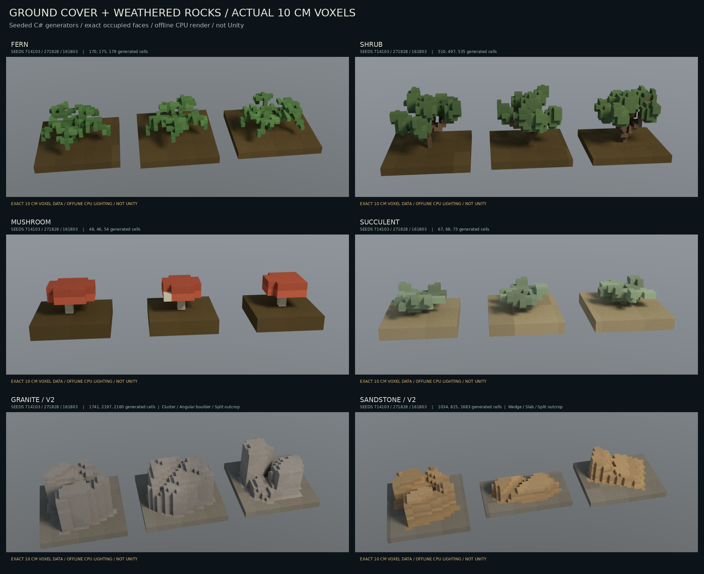

# Procedural ground cover and weathered rocks

The later [rock-shape update](ROCK_SHAPES_UPDATE.md) replaces the original
near-round rock geometry with six distinct families at RockGenerator2 and
GroundCoverProfile2. Original counts and version1 descriptions below record
that first update; current runtime/gallery rock geometry uses version2.

The new small-asset foundation provides ten plant families, five rock habits
and source-biome habitat placement. Every prototype uses actual 10 cm cells and
the existing authoritative `VoxelWorld.Set` path. There are no per-voxel objects,
independent Unity materials for individual plants, high-resolution replacement
meshes or unlabelled image-generation mockups.

## Inspect the mockups

Open `Assets/Scenes/GroundCoverWorkshop.unity`, or choose **Ashen Voxel → World →
Open ground-cover workshop**, then Play. The compact workshop contains ten plant
specimens, five rock specimens and a one-cell leaf reference. Tab/Shift+Tab
selects a specimen; O frames all; G changes the seed; R repeats it. RMB rotates,
MMB pans, wheel zooms and Home restores the selected framing. Labels report
physical dimensions, matter counts and limits.

WorldExplorer also generates these details in its finite P inspection region.
Source biomes, physical climate, ground material, slope, snow and water decide
the local mix. Toggle Generate Ground Cover, adjust Ground Cover Density or
change the cell budget in the Inspector before opening the region again.
Default limits are 256 placements, one million generator candidates and 60,000
new cells. Ground cover is built after the terrain, using its immutable source
sampler. A 1.7 m boundary margin keeps normal presets away from the patch edges.

This is still a free-flight inspection region with temporary edits; it does not
stream foliage continuously across an open world. ForestArena retains the
original destruction/gravity harness, and TreeWorkshop retains large trees.
The new workshop does not run wind, growth, seasons or granular stepping.

## A small shared material vocabulary

The catalog is now version 3 with 24 IDs including air. Existing IDs 0–21, their
base colors and their physical metadata are preserved. Only **Fungus (22)** and
**Petal (23)** are new. Snapshot Format 2 and Core Generation 5 remain unchanged;
existing saves contain their original self-contained material and tint state.
Older readers reject new IDs rather than reinterpret them.

| Organ or object | Material authority | Appearance |
| --- | --- | --- |
| Fern leaflets, grass, reeds, herbs, succulent/cactus tissue | Existing Leaves, also used by trees | Species/habitat palette with 2–6 quantized colors, default 4 |
| Woody shrub axes | Existing Wood | Muted woody shades; branch structure remains connected |
| Shrub berries | Existing Fruit | Optional supported berries with a small accent palette |
| Mushroom stem and cap | New Fungus | Cream stem and seeded cap variants within one bounded palette |
| Flower petals | New Petal | Small terminal accents; foliage remains Leaves |
| Boulders and outcrops | Existing basalt, granite, limestone, sandstone or shale | Up to six restrained shades of the parent rock |

The smallest height/radius settings emit one genuine occupied cell. Larger
plants use a few dozen to hundreds. At this scale individual leaflets, blades,
gills and spines are stylized aggregates. A 16×16 cutout representation remains
an optional future visual alternative; it is not implemented or used to hide
a different physical voxel scale.

## Constructive plants

`PlantPresets.For(kind)` returns an immutable `PlantProfile`; `.With(...)`
changes physical height/radius, stem count, density, fruit probability and the
small organ palettes. `PlantGenerator.Generate` consumes the profile, seed,
first-air base cell and explicit candidate/cell budget. It preserves foreign
matter and reports actual/requested bounds, blocked cells and truncation flags.

Shared bent axes, six-connected digital stems, tapering ribbons, radial or
phyllotactic attachments and bounded clusters form the vocabulary. Families
select different attachment/organ strategies rather than stretching one bush.
This is constructive static morphology, not a string-rewriting L-system or a
time-dependent growth/competition simulation.

| Family | Implemented signature | Default cells, seed 714103 |
| --- | --- | ---: |
| Fern | Five unequal arched fronds; spaced paired pinnae with visible gaps |170 |
| Shrub | Connected woody axes, separated leaf clusters and optional berries | 510 |
| Grass tuft | Unequal bent rooted blades |56 |
| Reed | Separated upright stalks, basal connections, narrow leaves and brown heads |176 |
| Broadleaf herb | Small stem with attached tapered leaf ribbons |42 |
| Flower | Herb structure plus a small terminal petal group |33 |
| Mushroom | Leaning stem and seeded cap profile, all Fungus |48 |
| Cactus | Fleshy upright mass with connected rising arms |74 |
| Succulent | Low radial fleshy leaves |67 |
| Alpine cushion | Compact low lobes/mat |48 |

Workshop specimens use their own recorded seeds and can have different counts.
The optional berry example forces fruit probability to 1 to make the attachment
visible; ordinary habitat shrubs keep berries sparse. Mushroom tissue does not
become Leaves just because both have color variants.

Initial previews revealed merged palm-like fern sheets and a tree-like reed
tuft. The final fern spaces its pinnae by about two cells, and the reed spreads
its main axes. Dedicated geometry checks and actual-data pictures verify those
changes instead of relying on parameter names alone.

## Weathered rock construction

`RockPresets.For(material,seed).With(...)` configures dimensions, embed depth,
weathering, joint strength and budgets. `RockGenerator.Generate` creates a
bounded anisotropic mass with asymmetric shoulders, broad rounded plane cuts,
seeded joints and material-specific cap/outline habits. Sandstone and shale
have recessed bedding; massive granite favors broader rounded forms. Joint
depths are physical and survive the 10 cm raster at ordinary boulder scale.

The implementation fills connected solid columns down to a shared buried root.
That restriction prevents accidental floating fragments and gives a stable
embedded outcrop, but cannot create arbitrary overhangs, arches or through
cavities. The default overwrite policy protects existing terrain and edits.
Candidate, column-evaluation, written, blocked and clipped counts are explicit;
count caps are not measured millisecond limits. A one-cell/thin shale
regression ensures the smallest accepted profile does not disappear after
subvoxel bedding recesses.

Weathering here is static shape construction and coherent pigment. It does not
implement dissolution, moisture transport, fracture dynamics or the optical
weathered-stone solver from the research literature. No exact signed-distance
property is claimed for displaced or composed cap fields.

## Habitat placement and stable ownership

`GroundCoverScatter.Plan` uses global seeded jittered candidates in three layers:
rocks, larger plants and small herbs. Fixed-distance priority rejection operates
only on neighboring hashes, then climate/substrate rules thin the survivors.
Coherent density patches retain open ground. Source biome remains independent
of the forest vegetation override. Six independent seeds, including integer
extremes, passed the whole-region versus quadrant ownership comparison.

| Source habitat | Main terrestrial floor choices |
| --- | --- |
| Marine | None under water |
| Hot desert / Sand Sea | Sparse cactus, succulent and dry tuft; rocks |
| Cold desert | Sparse cushion/dry tuft rather than tropical cactus |
| Savanna / grassland | Grass, herbs and small flowers; occasional shrubs |
| Tropical seasonal forest | Grass, broadleaf herbs, ferns and shrubs |
| Temperate forest | Fern, herb, fungus, shrub/berries and grass |
| Tropical / temperate rainforest | Wetter fern, broadleaf and fungus mixtures |
| Taiga | Smaller shrubs, grass, fungus and cushions |
| Tundra | Low cushions and short grass |
| Glacier | Exposed rocks; no terrestrial plants on glacier ground |
| Wetland | Reeds on wet emergent ground, herbs and suitable fungus |

Snow-covered, underwater, icy and excessively steep columns reject terrestrial
details. Ferns and fungus additionally require moisture/precipitation; actual
dry climate can therefore suppress them inside a nominal forest biome. There
is no canopy-light or competitive-growth model, soil-water solve or seasonal
population simulation. The current wetness is the shared local terrain proxy.

Neighbor exclusion never samples more terrain, so each evaluated candidate
needs only the existing 32 m surface-attribute halo. A column is evaluated once
per retained candidate. There is no HTTP or inference inside the classifier.
Positions are quantized globally, owned by a half-open requested region and
seeded by global key. This is deterministic hard-core placement, not an exact
Bridson sampler or a measured blue-noise spectral result.

Finite materialization follows canonical rock/shrub/herb order and preserves
existing solids. Candidate ownership is region/order independent when budgets
do not truncate; separate overlapping voxel-region composition still needs a
future deterministic conflict/ownership contract. Same-layer center separation
is not a proof that variable leaf envelopes never overlap. Such overlaps are
reported and preserve the first existing matter.

The 16×16 m controlled forest test produced 171 planned placements: 169 plants,
two rocks and 20,266 new cells from 71,301 generator candidates. Thirty-six
specimens encountered existing matter/overlap; aggregate budget truncation was
false. This is a headless count observation, not Unity FPS. The actual12.8 m
WorldExplorer build path has a separate integration check.

## Body collision and tool targeting

Leaves, Fungus and Petal remain saved solid matter for rendering and tools.
`MaterialCatalog.BlocksActorBody` supplies a separate body-query policy:
soft foliage is normally passable, while wood and terrain still block.
GridWalker exposes Collide With Soft Foliage to restore solid-foliage body
collision if wanted. This also makes tree Leaves passable; woody branches stay
physical. It avoids changing material IDs for fern leaves merely to change
their collision semantics. Actual DDA checks still hit all three soft tissues.
Native controller movement through clutter remains a Unity playtest gate.

## Research, pictures and verification

The [research notebook](UNDERSTORY_RESEARCH.md) connects the implementation to
ABOP's organ/fern construction, ecosystem placement work and Bailey's 2025
generalized plant framework. Dorsey's weathered-stone work motivates separating
geometry and altered pigment without claiming its physical solver. Golden-angle
attachment is a modeling choice, not a universal botanical optimality claim.

Latest Avroid Reddit requests returned 403 in this pass. The accessible official
landing clip showed an apple, not rocks or an environment. His earlier retrieved
author comments remain evidence; these new mockups are our procedural method,
not a verified reconstruction of his asset pipeline or a visual match claim.

The [gallery](GroundCoverGallery/README.md) contains 19 actual-data renders and
three contact sheets: all ten plants and five rock habits at three seeds,
one-cell examples, berry shrubs and floor compositions. CPU path tracing
renders the exact occupied faces and stored colors. Floor compositions are
explicitly authored arrangements of procedural specimens on controlled terrain;
they do not show neural terrain or validate habitat scatter visually. No Unity
or image-generated screenshot claim is made. Source/data/tool/image hashes are
retained; reproduction tools are included.

| Executed suite | Result |
| --- | --- |
| Plants | 93 checks;120 seed/juvenile specimens, palettes, attachment, bounds, budgets and fern/reed structure; C# 9/.NET Standard 2.1 |
| Rocks | 51 checks; five lithologies, five seed variants, connectivity, thin shapes, actual joints, palettes and caps; C# 9/.NET Standard 2.1 |
| Habitat / materialization | 50 checks; biome/climate rules, source override, half-open ownership, spacing, halo, caps and soft-body/tool split; C# 9/.NET Standard 2.1 |
| Workshop | 28 checks of actual generation iterator plus runtime/editor compilation with Unity substitutes |
| Explorer | 65 checks including actual baked climate and the full local clutter build, with Unity substitutes |
| Material compatibility | 53 checks, old colors/snapshots, all new IDs/tints, digging and granular behavior |
| Existing foundation | 87 Core checks, independent 27,208-face/108,456-AO mesh oracle, 44 surface, 27 climate and 55 world-scale checks remain passing |

The [independent review](GROUNDCOVER_REVIEW.md) additionally checked 380 plant
profiles, 150 seeded rocks, six planner partitions, all 24 collision-policy IDs
and 116 gallery hashes without relying on the owner test implementations.
Native Unity import, HLSL compilation, mesh/depth/shadow appearance, movement
through clutter and target-GPU performance remain unexecuted. Distant plant
LOD/instancing, continuous editable-region streaming, wind, structural falling,
ecological succession and growth remain separate extensions.

Core arena/tree generation is unchanged. Plant, rock and ground-cover generation
have independent version 1 contracts; the material catalog is version 3. Earlier
surface/tree/model reports and pictures remain historical evidence where their
recorded hashes predate this update. No old picture or raw model output has
been silently relabelled as a new execution.
