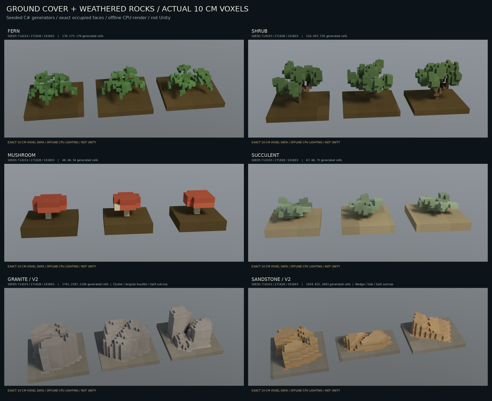

# Procedural ground-cover and rock mockups

These images render the exact occupied 10 cm cells and saved opaque material
colors emitted by the actual C# PlantGenerator and RockGenerator. Each species
and rock habit is shown with three recorded seeds. The procedural plant shapes
are not hand-painted sprites or replacement polygon models.

- [Ten plant kinds, three seeds each](plants-comparison.png)
- [Five weathered rock habits, three seeds each](rocks-comparison.png)
- [Six explicit rock shape controls and exact footprints](../RockShapeGallery/README.md)
- [One-cell mushroom, herb and flower examples](micro-plants.png)
- [Optional berry shrub using the same shrub generator](berry-shrub.png)
- [Forest-floor composition](forest-floor.png)
- [Dry-ground composition](dry-floor.png)

Ferns, grass, reeds, herbs, shrubs, cactus and succulents reuse the same Leaves
material as trees; woody shrub axes use Wood, berries use Fruit. Mushroom tissue
uses distinct Fungus. Flower petals use Petal. Individual plants use a bounded
small palette. Rocks use coherent restrained shades of their parent rock.
The 10 cm grid represents aggregate small leaves/needles and stylized mushroom
features, not anatomically resolved submillimeter plant parts.

Rock version2 selects genuinely different polygon/plane assemblies rather than
variations of an oval cap. The five material panels use Auto shape selection;
the separate six-shape study fixes all specimens to Granite to isolate shape.

The two floor views are authored arrangements of actual procedural specimens
on a controlled voxel floor, not an evaluation of world ecology or neural
terrain. Weathering is static shape construction, not erosion simulation.

Mitsuba CPU path tracing supplies only the camera, sky and area light. These
are not Unity screenshots, URP shader validation or player performance evidence.
No image generator, painted geometry or hidden high-resolution plant mesh was
used. Each dataset, profile, source snapshot, image and render tool has a hash.

Reproduce from project root: run Tools/GroundCoverPreview/export_ground_cover.py,
then render_ground_cover.py with 32 or 64 spp, then package_gallery.py. C# uses
the installed .NET 8 SDK without restore; rendering additionally uses Mitsuba,
NumPy and Pillow. Exported binaries and compiled assemblies are temporary under
Tools/GroundCoverPreview/bin and are excluded from project delivery archives.
