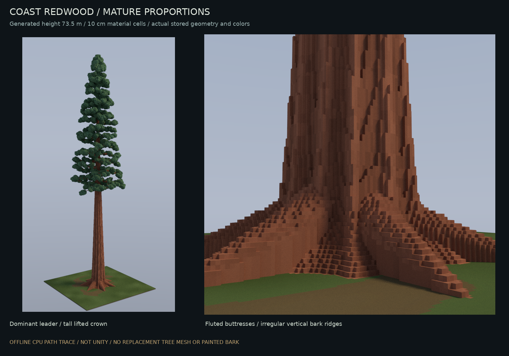

# Mature redwood update

Generation5 keeps10 cm cubic matter and the shared tree pipeline. The default Redwood profile now represents mature coast redwood: nominal75 m height,2.2 m stem-radius parameter,8 m crown-radius parameter, high crown, sweeping irregular scaffolds and a tapered apical crown. Physical bark relief is0.3 m with13 unequal wandering ribbons; larger basal flutes and root shoulders provide the broad silhouette. These are stylized botanical proportions, not a reconstruction of a particular living tree. [Reference evidence](REDWOOD_REFERENCE.md) distinguishes coast redwood, bark and buttress scales.

The images trace actual generated10 cm cells and their stored colors. They are offline Mitsuba CPU renders, not Unity screenshots. No replacement tree mesh or painted bark is used. The full gallery was regenerated, including13 complete untruncated seed/species exports. Source and image hashes are recorded and verified.

## Geometry and authoring

- Closely sampled leader taper localizes the root collar in physical meters, avoiding an inflated height-scaled flare.
- Adjoining trunk slabs replace repeated spherical endcaps, substantially reducing redundant voxel candidates on a large trunk.
- Unequal winding ribs remain continuous across trunk segments. Pigment follows the same structure; relief changes material occupancy.
- Root shoulders blend down into bounded solid buttress wedges instead of suspended cylindrical legs.
- Single, unevenly placed scaffolds, fuller three-dimensional foliage sprays and tapered apical laterals replace regular paired shelves and the previous narrow top pole.
- Bark Relief and Ridge Count are editable shared genome controls. Profiles support heights through120 m; age and seed also affect size. Workshop bounds and camera framing accommodate mature dimensions, and middle-drag pans to the base. Home restores the initial view.

Default limits remain explicit:4,096 branch segments,16 million voxel candidates and4,096 foliage clusters per tree. Limits report truncation; they do not promise a generation time. The candidate cap increased from12 to16 million to support the larger specimen. Normal small trees stop when their actual work is complete.

## Executed results

87 core checks,73 tree checks and40 authoring checks passed. Core also compiled as C#9/.NET Standard2.1. The mesh oracle matched27,208 unit faces/RGB and108,456 vertex AO values. Authoring checks compile actual sources against test Unity substitutes; they are not native Editor tests. Frozen image inputs, surface/color cases, source provenance and five final path-traced images passed verification.

The tree-check specimen at seed714103 has378,643 Wood cells,732,413 Leaves cells,2,016 segments and2,935 supported foliage clusters, with no truncation. Its13,624,984 candidates stay below16 million. All wood forms one grounded six-connected component; all foliage reaches wood. The occupied vertical range is73.8 m including buried roots, while the gallery top is73.5 m above its planting point. The palette preserves24 restrained effective leaf shades in the test.

The test world allocates1,761 chunks:7,213,056 material bytes and23,511,040 optional tint bytes, including its ground, excluding dictionary/simulation/mesh/GPU overhead. One unoptimized container observation took10.61 s to generate the tree synchronously. This is not a per-frame cost, FPS result or target-machine guarantee. The offline surface exporter reports roughly1.91 million exposed cell triangles; Unity greedy meshing produces its own topology and must be profiled separately.

The separate small-arena optimized benchmark was regenerated with source hashes and correctness gates. Its generation p50 is about1.07 s; it contains no mature redwood and does not establish mature-forest performance. See [results](Benchmark/RESULTS.md) and [tree validation](VALIDATION_TREES.md).

## Remaining verification

Unity is unavailable here. Editor import, actual profile deserialization, shaders, play mode and GPU/frame-time measurements remain unverified. Use the [mature-redwood playtest](PLAYTEST.md). The increased scale needs real mesh/upload/steady-view profiling before populating a large forest. Generation remains synchronous per specimen; caching, streaming and scheduled/job-based generation are subsequent performance work. Rigid tree collapse and biological growth remain separate systems. Recent Reddit forest videos remain inaccessible; no frame match is claimed.
