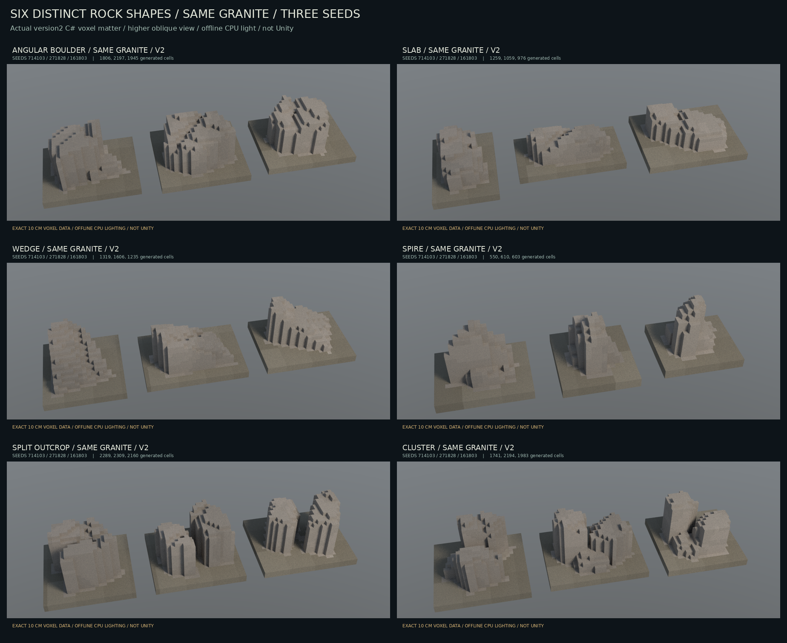

# Distinct procedural rock silhouettes

Rock generation 2 replaces the original near-elliptical footprint with six
independent shape families. The original chips and grooves changed surface
detail while leaving most rocks dome-shaped. The new primary forms change
outline, height planes, asymmetry and the arrangement of connected pieces.
The required 10 cm matter grid and existing five rock materials are unchanged.

## Shape controls

| Shape | Primary form |
| --- | --- |
| Angular boulder | Irregular clipped polygon with a lower broken shoulder |
| Slab | Long, low polygon with a tilted upper plane and chipped corners |
| Wedge | Asymmetric mass with a pronounced sloping face |
| Spire | Narrow fractured blade/pillar with an offset pointed cap |
| Split outcrop | Two unequal exposed masses separated by a substantial cleft |
| Cluster | Offset overlapping polygonal lobes with reentrant corners |

Weathering bevels the edges of those forms; joints and sedimentary bands add
secondary detail. It no longer starts every specimen from the same radial
envelope. Seeded corner changes, rotation, cap slopes and piece proportions
vary each family. Color stays within the same restrained parent-rock palette.

`RockProfile` adds `Shape` and deterministic `ResolvedShape`. `Auto`, the
default, chooses a material-biased family from the seed. An explicit shape
overrides that choice. Shape is independent of material, so granite can form
a slab, wedge, split outcrop or cluster without acquiring a new material ID.

```csharp
var rock = RockPresets.For(MaterialId.Granite, seed: 714103)
    .With(shape: RockShape.SplitOutcrop,
          widthMeters: 2.2, heightMeters: 1.3, depthMeters: 1.8,
          weathering: .8, jointStrength: .4);
RockResult result = RockGenerator.Generate(world, firstAirCell, rock);
```

`With(seed: ...)` recomputes an Auto family; explicit shape controls remain
explicit. Profile identity records both requested and resolved shape, all
physical controls, budgets and generator version. Core arena/tree Generation 5,
catalog 3 and snapshot Format 2 are unchanged. Existing saved matter is not
regenerated or reshaped by loading it.

## Placement and workshop

The habitat layer now preserves the chosen family's proportions. Slabs receive
low height-to-width ratios, spires receive tall narrow proportions, and split
outcrops/clusters retain broader footprints. The former common short-boulder
aspect ratio no longer flattens every family in WorldExplorer's local patch.
GroundCoverProfile is version 2 because those placement dimensions changed;
plant morphology and candidate positions are unchanged.

Open **GroundCoverWorkshop.unity**, press Play and use the Inspector's
**Compare six rock shapes** button. The Rock Shapes layout shows all six
controls in one material with matched seed/dimensions. Shape Study Material
can switch the comparison to basalt, limestone, sandstone or shale. Full
Collection keeps all 15 original plant/rock specimens, with an optional Rock
Shape Override. G changes the seed; R repeats it; Tab selects and O frames all.

The gallery's controlled six-shape study fixes Granite and uses three seeds
per family. Its high oblique camera and separate exact-footprint diagrams make
noncircular outlines visible independently of color. A Spire retains an
intrinsically narrower footprint even when the nominal dimensions match the
other controls. In habitat placement its taller profile reinforces that form.

## Matter, support and bounds

Each form is built from a small fixed number of clipped convex polygon pieces
and bounded cap planes. Piece unions can have concave footprints and visible
separations. Columns continue into shared buried connectors, keeping a complete
unclipped specimen one six-connected material mass. A split outcrop can thus
have separate exposed lobes while remaining joined below the ground plane.

The connector footprint includes a small digital-grid margin to avoid a
diagonally touching fragment at tiny scales. At zero/subcell burial it becomes
a visible one-cell connection rather than silently leaving detached pieces.
Very small profiles retain a visible anchor instead of disappearing under
rounding or a split. Clipping, existing obstructions and truncated generation
remain explicit; those cases are not promised to retain complete topology.

Dimension limits, non-overwriting placement, six-color maximum, candidate/write
caps and current material authority remain intact. Shape construction and
column evaluation have additional bounded work outside counted cell visits;
count caps are not millisecond guarantees. These are static weathered forms,
not fracture, erosion, dissolution or rigid-body simulation. The cap-column
representation still does not create arbitrary undercuts, through-caves or arches.

## Pictures and evidence



The [shape gallery](RockShapeGallery/README.md) includes six same-material
families at three seeds, exact above-ground footprint diagrams and a matched
before/after view. The normal [material gallery](GroundCoverGallery/rocks-comparison.png)
and authored forest/dry floor compositions are regenerated from version 2.
All pictures trace actual occupied 10 cm cells and saved pigment with offline
CPU lighting. They are not Unity screenshots or replacement meshes.

The historical before image/data comes from the published version 1 source,
preserved outside active assets before changes. It retains its original
identity and hashes. Its measured visible footprint fit a covariance ellipse
at 0.9604 intersection-over-union, supporting the observed roundness problem.
The independent review records the new shape metrics and seed-family coverage;
those measurements describe fixtures rather than a universal appearance score.

Validation covers deterministic seeds, shape identity, polygon footprint
asymmetry/concavity, material-independent occupancy, connectivity, dimensions,
minimum-scale profiles and strict budgets. Habitat integration checks require
multiple Auto families, actual flat-slab and tall-spire proportions. Workshop
checks compare six translated occupancy hashes while ignoring color, so merely
changing material names or tint cannot pass as a shape change. Independent
fuzzing includes small scattered-rock scales and burial thresholds.

Executed verification: **69 rock checks** (including 480 morphology cases),
**51 habitat/materialization checks**, **42 workshop checks** and **65 explorer
integration checks** passed. The independent review additionally passed **5,928
profiles** across materials, sizes, aspect ratios, seeds and burial thresholds.
Core87 and its unchanged arena/tree fixture also pass.

Current executed counts/hashes are in `rock-validation.json`,
`groundcover-validation.json`, `groundcover-workshop-validation.json` and
`world-explorer-validation.json`; the [independent review](ROCK_SHAPE_REVIEW.md)
records its separate probes. Native Unity import, shader/rendering, player
movement and target-hardware frame time remain unexecuted verification gates.
The original plant/material/update reports remain historical wherever their
recorded sources predate this geometry change.
