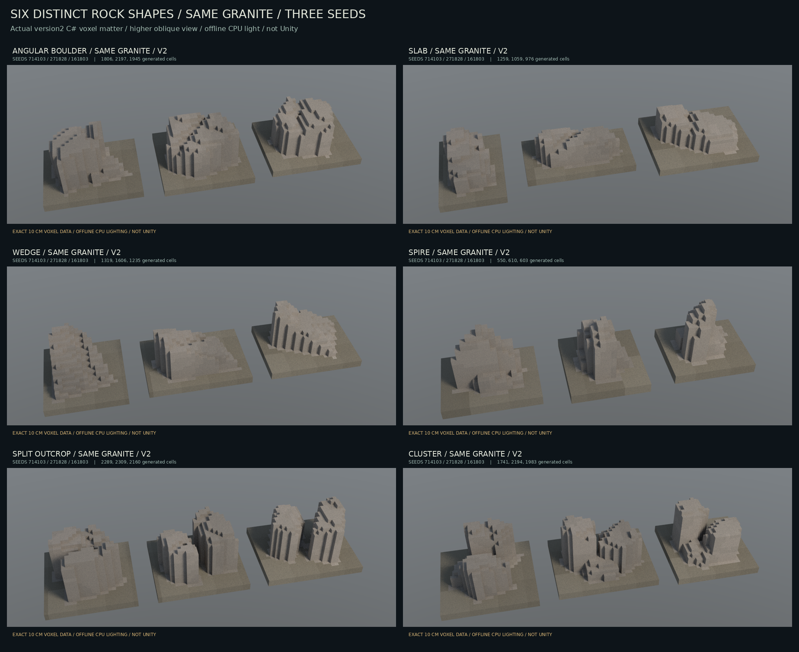

# Distinct procedural rock shapes

These are actual version 2 rock-generator outputs on the 10 cm voxel grid.
Each row uses the same Granite material, nominal physical profile and three
seeds: 714103, 271828 and 161803. Shapes are explicit controls rather than color
names: angular boulder, slab, wedge, spire, split outcrop and cluster. The Auto
mode chooses a material-appropriate family deterministically from the seed.

[Exact above-ground footprint diagrams](footprints-comparison.png) remove
lighting and camera effects. Each filled square represents an occupied 10 cm
column above the presentation pad. Buried connecting roots are excluded. The
recorded area and convex-fill ratio describe the emitted grid footprint; they
are geometric measurements, not a score of visual realism.

[Before/after pictures](before-after.png) and [footprints](before-after-footprints.png)
compare preserved historical version 1 data with the new version 2 Auto results
using the same Granite and three seeds. The photography uses the same view
direction, FOV, exposure and lighting rules; framing fits each actual group.
Historical data retain their original source hashes and version labels.

The main [ground-cover gallery](../GroundCoverGallery/README.md) includes five
material panels under Auto selection and the updated controlled forest/dry
compositions. Rock surfaces retain their limited coherent parent-material
palette. Geometry uses irregular polygon pieces, plane cuts, bevels and joints;
this is static procedural morphology, not physical weathering simulation or
unrestricted 3D fracture/cave geometry.

The photographs trace exact exposed voxel faces offline with Mitsuba. They are
not Unity screenshots or runtime performance evidence. Footprints are direct
binary occupancy diagrams, not painted outlines. Source/data/render/image
hashes and per-seed measurements are in shape-gallery-validation.json.
Reproduction commands live in [the tool guide](../../Tools/RockShapePreview/README.md).
