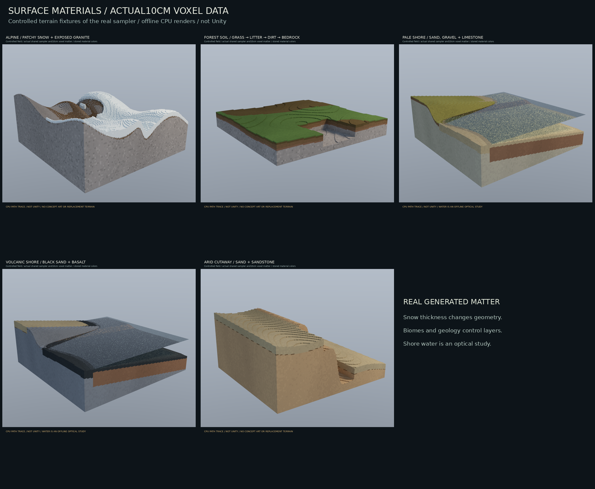

# Surface materials, mountain snow and visual water

This records the surface-material update at catalog version2. The later
[ground-cover update](GROUNDCOVER_UPDATE.md) appends Fungus/Petal at version3
and adds plants/rocks; historical counts and pictures below retain that scope.

WorldExplorer now uses a shared, versioned surface classifier for distant height
proxies, implicit matter and the finite editable 10 cm inspection region. It
produces coherent geology, climate-dependent cover and actual layered matter.
This update extends terrain appearance and material authority; continuous
persistent near-field streaming remains a separate implementation gate.

## Try it

Open `Assets/Scenes/WorldExplorer.unity` and press Play. The World menu also opens
the imported Ceteviles map and the bundled actual pretrained-model samples.
Matching baked climate archives are assigned automatically. Native Unity import
and shader/player verification are still pending because this environment has
no Unity Editor.

WASD and Q/E fly, RMB looks, Shift accelerates and Home moves above the terrain.
P creates the finite editable 10 cm region at the camera; LMB excavates. P again
discards those temporary edits and returns to the vista. This scene has no
walking controller or granular stepping; ForestArena retains those original
interaction demonstrations. See the [runtime guide](../Assets/AshenVoxel/WorldScaleRuntime/README.md)
for complete controls and limits.

Change the surface settings in the WorldExplorer Inspector, then R/Rebuild:
Snow enable/max depth, wind strength/azimuth, climatic solar azimuth, winter
fraction, temperature bias, reference snowline and sea level. Defaults allow
up to2.4 m of snow. Snowline controls biome-derived fallback climate; genuine
model climate already contains its original elevation adjustment. The climatic
sun direction changes retention, not the scene light. Tool power 10 can cut
granite while retaining distinct material hardness.

## Materials and layers

The catalog now has 22 IDs including air, with 11 newly appended materials.
The existing `Stone` ID remains basalt. Existing saved IDs 0–10 and their original
base colors are unchanged.

| Group | Implemented matter | Purpose |
| --- | --- | --- |
| Bedrock | Basalt, granite, limestone, sandstone, shale | Coherent provinces and warped sedimentary beds; different tool hardness |
| Coarse deposits | Sand, black sand, gravel | Shores, arid ground and coarse slope debris; volcanic parent controls black sand |
| Fine/wet deposits | Mud, clay, silt, peat | Wet low areas, fine sediments and organic-rich ground |
| Living/organic cover | Grass, litter, dirt | Biome-colored surface, organic horizon and mineral soil; existing tree materials remain available |
| Frozen matter | Snow, ice | Variable positive-volume snow and conditional frozen underlying material |

Not every column receives every layer. A temperate forest can expose
grass → litter → dirt → sediment → bedrock; exposed mountains omit deep soil,
while shores use sediment over their underlying geology. The classifier keeps
unconsolidated arid deposits separate from cemented sandstone. Hardness and
density are game-oriented distinctions, not measured mechanical constitutive
laws. Granular flags use the existing simple solver wherever that solver runs;
cohesion, avalanches, structural fracture and erosion are not added here.

Generated pigment combines biome palettes, broad variation, mineral patterns
and restrained cell variation. Grass can therefore change color between biomes
without introducing a separate behavior ID for each color. Saved intrinsic
opaque sRGB tint remains separate from lighting and moves with granular matter.
Geology is coherent across neighboring cells rather than randomly choosing a
different rock ID at each cell. Tiny grains and mineral crystals below 10 cm
are represented through color/shading rather than physical subvoxels.

## How placement works

`SurfaceMaterialSampler.EvaluateColumn(x,z)` gathers terrain height and climate,
then evaluates slope, local relief/curvature, wind shelter, exposure and a
wetness proxy at fixed physical scales. Its 11 height queries use 2 m, 24 m and 32 m
stencils independent of LOD mesh triangles. The returned immutable column is
reused by `SampleMatter` for every vertical cell; no new source queries occur
per cell. The warmed sampler allocates zero managed bytes in the executed
headless check. These observations do not establish a Unity frame-time budget.

The rules use the **source biome**, preserving desert, glacier and other
ground types even when the older vegetation override requests forest trees.
When present, the original model's five climate channels supply physical
surface temperature, seasonality, precipitation, precipitation variability and
lapse rate. Otherwise a documented biome/elevation fallback is used. The system
does not turn a 30 m model or coarse map into measured centimeter-scale relief.

Coldness and precipitation set available snow; slope retention, directional
wind shelter, curvature, solar aspect and coherent patch variation shape depth.
Depth is quantized to 10 cm and added above bare ground. Wind-scoured and steep
surfaces can remain rock; sheltered terrain can accumulate thicker snow.
Proxy heights and actual local Snow cells use that same result. The executed
surface fixture had 267 bare and 1414 snowy columns, with seven depths through
1.1 m; the separate gallery alpine fixture reaches 1.2 m.

This is a research-informed static terrain heuristic. It does not solve
conservative snow transport, energy balance, melting, avalanche dynamics,
sediment transport or a drainage network. The wetness value is not a solved
topographic wetness index. The [research notebook](SURFACE_RESEARCH.md) explains
the mapping and limits against 2024–2025 snow and microtopography research,
including [Quéno et al.](https://tc.copernicus.org/articles/18/3533/2024/) and
[openAMUNDSEN](https://gmd.copernicus.org/articles/17/6775/2024/).

## One authority across distance

Far vertices use the same column height, rock selection and pigment as local
cells, including the actual top-cell center for exposed rock. Surface identity
includes profile version 1, catalog version 2 and all climate/geology/wind/sun
settings. Conservative terrain bounds include maximum possible snow depth.
Proxy UV attributes convey roughness, wetness and snow; voxel chunks without
those attributes use the generic roughness fallback. The shader supports
cosmetic grain, disabled on automatic runtime materials by default; optional
nonzero grain can change at the 4096 m origin-phase wrap. Each explorer owns its
mutable material copy, including when an Inspector template is supplied.

The remote adapter keeps all five climate channels in its bounded cache
(128 MiB decoded payload, plus separately accounted immutable snapshots).
Materialization requires the full 32 m source halo. It uses an immutable
height/climate snapshot so cache eviction cannot silently regenerate the local
matter from rough fallback terrain. Surface sampling never performs HTTP or
inference itself.

## Climate interface correction

Reading the real model outputs revealed that upstream seasonality is returned
in **centi-degrees Celsius**, while its first temperature channel is already
elevation-adjusted Celsius. Treating both as Celsius would reject real regions
and break snow placement. New immutable jobs use explicit `physical-si-v2`
metadata and convert the second channel once before caching. Legacy jobs retain
their identities and convert once at the consumer boundary. Unknown or
contradictory encodings are rejected without guessing from numeric ranges.

Both bundled neural samples now have checked physical-climate archives paired
to the exact height SHA256, grid and world ID. Horizontal transforms remain
shared; vertical rescaling applies temperature correction only for the change
from the original elevation. The [unit report](CLIMATE_UNITS.md) and
[conversion evidence](SurfaceEvidence/CetevilesNeural-climate-conversion.json)
record the correction without relabelling historical raw arrays.

A fresh real pretrained run passed seven inference/overlap/replay checks.
Heights and the other four climate planes remained bit-identical to the
retained same-region output; corrected seasonality matched old values × 0.01.
The first canonical region took 196.33 s on four CPU threads. This is generation
cost, not gameplay FPS. [Executed model evidence](SurfaceEvidence/physical-si-v2-model-validation.json)
records exact identities and versions.

## Visual water

The sea is a bounded 32×32-cell camera-centered surface grid: 1089 vertices,
2048 triangles. The URP shader supplies filtered gentle wave normals, Fresnel,
depth-hint color. It does not implement a depth-based alpha shoreline fade.
A slight underwater color wash is enabled
only below sea level and above the sampled bed; inside a retained inspection
region it uses that region's immutable source. Origin rebasing preserves the
wave phase, remote arrivals invalidate bed hints, and cleanup releases owned
meshes/materials without modifying global fog or source assets.

There are no water material cells, flow, buoyancy, hydraulic erosion, physical
waves or connected-ocean/lake solving. Any below-sea depression may appear
flooded. Depth coloring is a coarse bed hint, not true per-pixel scene-depth
refraction. These deliberate limits keep visual water expandable without
making it authoritative voxel matter. See [water implementation](../Assets/AshenVoxel/WorldScaleRuntime/VISUAL_WATER.md).

## Pictures and verification

The [five individual previews](SurfaceGallery/README.md) use actual C# sampler
output materialized through `VoxelWorld.Set`, exact exposed 10 cm faces and
stored voxel colors. They are controlled terrain/climate/geology fixtures,
rendered offline with Mitsuba; they are not neural world screenshots or Unity
renders. The shore water is a separately labelled dielectric optical study,
not evidence of the URP water shader. Source, profile, data, renderer and image
hashes accompany the gallery.

| Executed check | Result and scope |
| --- | --- |
| Material compatibility | 49 checks; 1221 historical golden color samples, old Format 2 fixture, new IDs/tints, hard/soft digging and mass/tint conservation |
| Surface rules | 44 checks; layer order, snow coverage/depth, geology coherence, deterministic pigment, source biome and zero-allocation column sampling |
| Climate archive | 27 checks with actual Ceteviles height/climate pair; CRC, identity, unit and transform validation |
| World-scale data | 55 checks with the actual Ceteviles neural atlas; long/double coordinates, implicit matter/edit invariants, LOD bounds and atlas contracts |
| Visual water | 28 headless C# checks plus static shader/material reference checks |
| Runtime integration | 66 checks for each actual live encoding, including actual baked climate; actual C# with Unity API substitutes |
| Bridge transport | 61 fake-backend contract checks, separate from seven actual pretrained-model checks |
| Existing Core/mesh/tree/authoring | 87 Core, independent27,208-face/108,456-AO oracle, 73 tree and 40 authoring checks remain passing after the catalog extension |

Engine-independent data also compiled as C# 9 against .NET Standard 2.1.
The [legacy live report](SurfaceEvidence/runtime-legacy-live.json),
[physical-SI live report](SurfaceEvidence/runtime-physical-live.json) and adjacent
JSON reports record executed source hashes. Native Editor import, serialized
scene behavior, HLSL compilation, underwater draw order, GPU cost and player
performance require Unity. The default finest proxy spacing is still 2 m;
a 100 m full-resolution ring, seamless persistent editing, vegetation LOD and
watertight voxel/proxy transitions are not established by this update.

Core Generation 5 is unchanged because its existing arena/tree geometry is
unchanged. Surface generation has its own new version 1. Snapshot Format 2
already stores byte material IDs, so appended IDs require no container change;
old worlds load with their original material/appearance data. Older readers
will reject newly introduced IDs. The protected finite inspection floor and
temporary edits are retained; there is no new persistent world-save claim.
