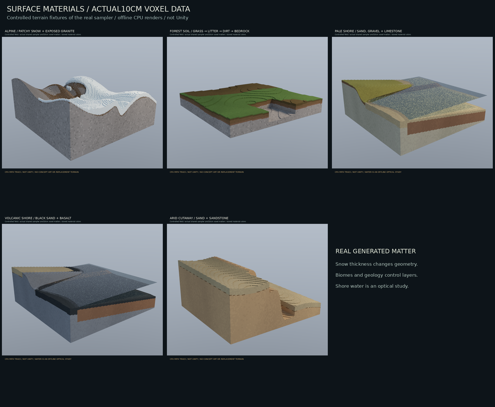

# Actual surface-material examples

Full images: [alpine snow](alpine.png), [forest cutaway](forest.png),
[pale shore](pale-shore.png), [volcanic shore](black-shore.png),
[arid sandstone](arid.png).

These are controlled synthetic terrain fields and artist profiles passed through
the actual shared C# SurfaceMaterialSampler, then materialized as10cm cells with
VoxelWorld.Set. They are not Ceteviles or neural terrain outputs. No concept-art
generator, replacement mountains, vegetation or painted texture is used.

The five fixtures show alpine snow and exposed granite, a forest soil cutaway,
pale sediment and gravel on limestone shores, black volcanic sand and basalt,
and an arid sandstone cutaway. Snow depth is actual positive-volume Snow cells.
Forest cutaways expose grass/litter/soil/bedrock from the real layer order.

The renderer traces exact exposed cell faces and saved opaque material colors.
Mitsuba CPU path tracing, sky and light are presentation fixtures. Shore images
add a separate flat dielectric surface at mean sea level as an optical study;
this is not the Unity water shader or fluid simulation. The actual URP shader,
underwater effect and player performance remain separate native verification.

Each image and dataset has recorded hashes, physical dimensions, material
counts, snow depth/coverage statistics, camera and source/profile provenance.
Temporary datasets/assemblies live underTools/SurfacePreview/bin and are not
project assets. Run export_surfaces.py, then render_surfaces.py for each named
fixture, and finally package_gallery.py to reproduce from project root.
