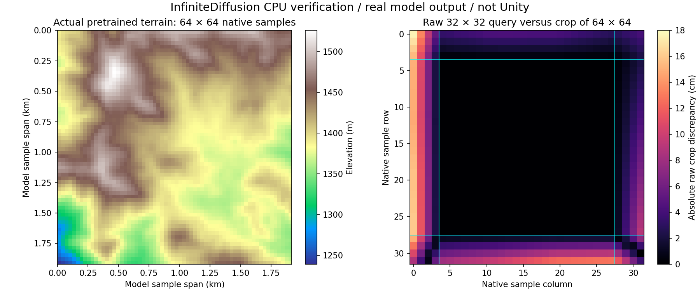

# Executed pretrained InfiniteDiffusion CPU smoke

Executed26 October2026 in the development Linux container. **Actual pretrained neural inference ran successfully**, producing finite meter elevations and climate. The stronger test asserting exact equality of an independently cropped raw query **failed**. This finding is preserved rather than weakening the assertion or calling the raw pipeline fully validated.

## Environment and source

- Python3.12.14, PyTorch2.14.1+cpu, Diffusers0.42.0, Infinite Tensor0.4.0; CPU only, four Torch threads, one interop thread, float32, no`torch.compile`, latent batch1 and256 MiB direct LRU cache.
- Python source commit`e8dcb4b1a834ab2f6b1a6f5256ed7c9f2f3e8230`; all inference used the real`WorldPipeline` with`MOCK=False`,`T=2`, genuine coarse/base/decoder weights and seed714103.
- Model`xandergos/terrain-diffusion-30m`, pinned revision`9ef8030cb805b433b98ec25c5dddefbac07a9e26`. All three safetensors files were checked against the public model API's SHA256 values. Total weight bytes:1,137,682,120.
- Official synthetic-map quantile statistics came from`pipeline_data.json` at ONNX revision`ad2df557eca5645f588766101cf3bc3682455c3e`, SHA256`e3132c3ef0c65d8613615f9278ffe23bbd9363ddcd87f1cc6f18456bcc9efe5c`. No new WorldClim download, training, stub denoiser or synthetic replacement output was used.

The isolated environment and complete commands/logs remain outside the Unity project at`/workspace/infinite-diffusion-venv` and`/workspace/infinite-diffusion-smoke`. Model binaries are not bundled with the project. The latter directory includes the download script, verified model manifest, dependency freeze, inference script, two run logs, reports and actual NumPy outputs.

## Output and observations

A deterministic coarse search selected a highland region, then queried64×64 native samples at30 m spacing, row608/column1120. The returned height field spans **1239.2135–1526.0205 m**, mean1413.2512 m, standard deviation42.0357 m. All64×64 height samples and all five64×64 climate channels are finite. The output elevation file SHA256 is`1fa664e45149337a4046a4d4063647ae988e1bbd4d4b1aa19d6108f5d759ba51`.

Two independent cold process runs produced that same fixed-region file hash. Observed model loading was1.22–1.30 s, coarse selection8.22–9.86 s and the first64×64 query92.27–94.39 s. Repeating the same query while cached took about2–3 ms and returned exactly equal elevations. Peak process RSS was approximately2.85 GiB in these runs, excluding separate processes and filesystem cache. These are limited CPU observations with changing host load; they are not GPU measurements, Unity FPS or a general throughput guarantee.

## Raw cropped-query failure

Querying the inner32×32 region separately returned447 changed samples out of1,024, with maximum absolute discrepancy **0.1761474609375 m** and RMSE0.044306 m relative to the matching crop of the64×64 query. This exceeds one10 cm cell and must not be described as harmless bit-level roundoff.

The observed discrepancies are confined to the cropped request's outer four native pixels. Removing that four-pixel border gives exact equality over the remaining24×24 samples. This localizes the symptom to the output query edge in the tested reconstruction path; it does not establish the cause generally, invalidate the paper's formal algorithm, or prove behavior for other devices/checkpoints/coordinates.

The raw smoke report retains`FAIL` for its strict partition-equality assertion, alongside successful finite output and exact same-query repeat results. The first attempt is retained separately from the diagnostic rerun. Actual overlap and repeat arrays were saved for independent inspection.

The figure visualizes actual saved samples. The cyan box excludes the four-pixel boundary where this cropped-query comparison differs. It is a diagnostic data plot, not a rendered Unity landscape or a quality comparison with the user's appearance reference.

## Operational consequence

Use a fixed global tile owner, a declared generation identity and padded backend requests whose halo is cropped before publication. Assemble arbitrary consumer queries from those canonical owner samples. Cache checksums and immutable owner metadata make the representation stable across caller partitions; a single exact global owner also avoids conflicting duplicated boundary samples.

That wrapper is a project integration policy requiring its own tests, including real pretrained queries. It is distinct from asserting that raw upstream requests of every size are bit-identical. Cold replay of the same fixed request has been observed here; arbitrary request-order replay, cache eviction, negative positions, device parity and production-sized worlds have not yet been established by this small smoke alone.

The neural result demonstrates a real working model path. It does not demonstrate a finished Unity streaming forest,10 cm learned detail, large-distance rendering, model-conditioned import of the complete user map, or target-machine frame times.

## Subsequent integration verification

The separate canonical owner wrapper has since passed actual model height and
climate overlap/replay checks, and the actual Ceteviles Full JSON has passed
through five-channel conditioning into a learned33×33 region reaching
5,145.75–5,803.96 m. This is an executed conditioned region, not generation of
the complete1,800 km map. Current-code warm replay and historical cold timing
remain separate records. See the [evidence index](WorldScaleEvidence/README.md)
and [world-scale implementation report](WORLD_SCALE_UPDATE.md). The original
strict raw-query failure above remains unchanged.
