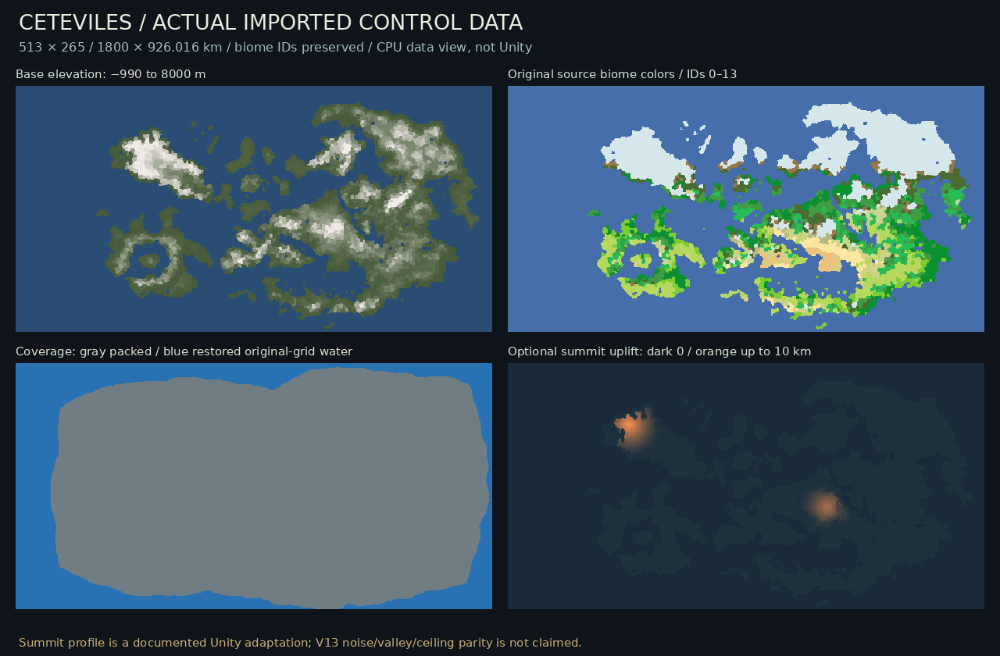
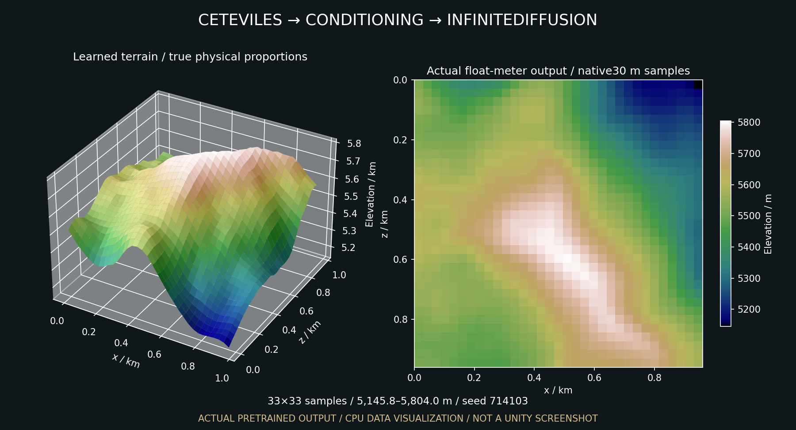

# InfiniteDiffusion, Azgaar and long-range terrain

The original InfiniteDiffusion pipeline now runs behind a local provider, with
an asynchronous Unity client and a separate WorldExplorer scene. The actual
Ceteviles map has passed through conditioning and the pretrained model into a
Unity-readable sample. The existing forest arena and tree generator remain
unchanged. This is a researched and tested integration prototype, not a claim
that a production infinite editable voxel game has only bugs left.

## What the research changed

[InfiniteDiffusion](https://arxiv.org/html/2512.08309v4) is a learned height and
climate generator with lazy overlapping queries. It does not generate 10 cm
volumetric matter. The selected model operates at 30 m spacing; the Unity
material system supplies the fine grid separately. Using the original pipeline
preserves its region generation and finite/periodic conditioning behavior,
rather than renaming a noise field after the paper.

The supplied .41 mod source/history was received and its present payload
verified against the inventory. The relevant lessons are authored map
transforms, separate elevation/climate noise controls, explicit terrain and
preview identity, bounded inference, readiness/error reporting and cheap far
previews. Settlements, roads, buildings and unrelated Minecraft systems were
excluded as requested. [Selected source findings](MOD_PARITY.md) distinguish
implemented controls from further exact custom-mod parity.

A 100 m-radius footprint filled just 20 m deep costs roughly 2.93 GiB raw with
the current material/color channels. Filling that footprint to an 8 km mountain
height is roughly 1.14 TiB. The implementation therefore separates a height
field, implicit buried stone, sparse edits, local matter and distant meshes.
Increasing the finite arena's vertical array was rejected.

## What is implemented

- **Original model integration:** pinned source/model/statistics, real pretrained
  inference, arbitrary signed native region requests, all five climate planes,
  finite and periodic conditioning, immutable configuration, bounded queues,
  deduplication, cache limits, error latching and optional float-meter baking.
- **Authored maps:** Full JSON and Pack Cells JSON import, independent physical
  width/depth, landmass zoom, elevation controls and source biome preservation.
  The optional Forest override affects land only. Native `.map` needs export
  through Azgaar; ambiguous GeoJSON height units are not guessed.
- **Real-map coverage:** packed cells intentionally omit deep ocean. Ceteviles
  needed 29,990 samples restored through original-grid water data. Missing land
  still fails instead of borrowing the nearest packed land biome.
- **Large coordinates:** double positions, signed 64-bit cell keys and
  camera-relative tile placement. Stone below a summit is sampled implicitly;
  it does not allocate a full column from sea level.
- **Distant terrain:** balanced bounded quadtree selection, conservative atlas
  height bounds, tile-local meshes, budgeted construction, complete-plan swaps
  and bounds-aware skirts. Default view distance is 32 km; the inspector allows
  100 km for testing.
- **Live preview/refinement:** rough far terrain remains explicitly provisional;
  bounded nearby regions load asynchronously from the model and replace proxy
  meshes. No HTTP or inference occurs inside per-vertex sampling. Local matter
  requires complete model data and retains an immutable region snapshot.
- **Inspection/demo:** WorldExplorer has free flight and a separate temporary
  12.8 m-wide, 25.6 m-high region using actual 10 cm cells and excavation. This
  is not a seamless or persistent moving voxel ring.

The source Ceteviles map was imported at **1,800 × 926.016 km**, retaining biome
IDs 0–13, including its Sand Sea extension. The bundled macro atlas uses
−990 to 8,000 m. Optional summit annotations have a separate documented Unity
uplift adaptation; they are not claimed as a bit-exact copy of Minecraft's
ceiling/noise profile. Live model world scale is configured in its immutable
conditioning job; conflicting client-only rescaling is rejected.

## Real model results and problems caught

An unconditioned official-model query produced finite elevations and five
climate channels. Repeating the same query was exact, but separately requesting
a cropped region differed by up to **0.176 m** at its edges—more than one voxel.
The raw failure is retained in [the diagnostic report](VALIDATION_INFINITE_DIFFUSION.md).

The bridge now gives each native pixel a fixed owner query with a 32-pixel halo,
then publishes only the owner's interior. Real-model canonical height/climate
overlaps and owner-disk replay passed exact comparison. The scope is one tested
owner and the recorded requests; adjacent-owner behavior, GPU parity and model
cache eviction/recompute still need broader validation.

The actual imported Ceteviles JSON then generated five conditioning fields and
a genuine learned region reaching **5,145.75–5,803.96 m**, including source biome
11 and all five climate planes. This output was read through the actual C# atlas
reader. The asynchronous C# client also consumed real pretrained output from the
HTTP provider in an executed integration check.

These are CPU data visualizations and actual-data samples, not Unity screenshots.
The first raw query took about 92–94 s on four CPU threads. A larger padded owner
query took about 185 s; later cached reads are much cheaper. Observed model
process memory was roughly 2.8 GiB. These timings establish neither GPU
throughput nor playable streaming frame times. Weights are not in the ZIP.

Independent review also reproduced a **5,184 m uncovered LOD edge gap** on a
6,200 m needle peak. Bounds-aware skirts now cover that case. The review fixed
a model-height/culling-bound mismatch, atlas changes after an editor cancel,
and misleading live source scale/origin combinations. Skirts still are not a
watertight voxel transition, and very deep skirts can add draw cost.

## Run it

Open **Ashen Voxel → World → Open world explorer** and Play. Its default analytic
mountains are labelled as a fallback, not neural output. The same menu opens the
actual baked neural sample, imported Ceteviles map and conditioned Ceteviles
neural sample. Imported dimensions and aspect are preserved by default.

Use WASD, Q/E or Ctrl/Space, RMB look and Shift acceleration. P opens the
separate finite voxel inspection mode. Read the [runtime guide](../Assets/AshenVoxel/WorldScaleRuntime/README.md)
for controls and limits. For live model terrain, follow the [provider setup](../Tools/DiffusionBridge/README.md),
including model/statistics preparation and a matching immutable job. A local
Python service is required; inference is not embedded in Unity's assemblies.

The [implementation plan](WORLD_GENERATION_PLAN.md),
[LOD/scaling research](WORLD_SCALE_RESEARCH.md),
[Azgaar research](AZGAAR_IMPORT_RESEARCH.md) and
[diffusion research](INFINITE_DIFFUSION_RESEARCH.md) provide methods and sources.
Validation artifacts are linked in the [evidence index](WorldScaleEvidence/README.md).

## Remaining gates

Unity is not installed here. Native Editor import, serialization, shaders,
player builds, GPU/depth/shadow behavior and frame-time profiling have not run.
The standalone runtime checks use Unity API substitutes, including JsonUtility.

The full-resolution 100 m ring is a target, not an implemented setting. Current
proxy spacing starts at 2 m. Continuous persistent editable-region migration,
seamless near/far voxel transitions, streaming tree LOD, structural/granular
simulation across regions and robust GPU occlusion remain separate engineering
work. Occlusion helps valleys but cannot hide most terrain from a mountaintop.
Rendering culling must never discard unsaved edits or authoritative simulation.
